# Bill lifecycle: design (option C)

Built (migration 0006, `app/billing/settlement.py`; slices 1-4). Chosen 2026-10-10 over
the derived (A) and stored-oldest-first (B) options. Section numbers are cited by code and
tests. What was built, with deviations, is in [decisions/bills.md](../decisions/bills.md);
this note keeps the TMF678 state model, the settlement arithmetic and the design decisions.

---

## 2. The TMF678 state model

From `spec/TMF678-CustomerBill-v5.0.0.oas.yaml:1753-1765`, `CustomerBillStateType`:

```
new | onHold | validated | sent | settled | partiallyPaid
```

The spec calls it a "Recommended Enumeration Type (not formal forced in standard)" and
gives these meanings: new = ready to validate or to send; validated = checked (manually or
automatically); sent = sent through the channel defined in the billing account; settled =
paid; onHold = no further processing until open issues are solved. **The description says
`partiallySettled`, but the enum value is `partiallyPaid`.** The enum is authoritative,
and `test_enum_lock.py` already compares against it.

The spec defines no transitions. It also has **no overdue, unpaid, written-off or
cancelled state**. Payment status and document status share one field.

Related spec fields:

- `CustomerBill` (`:1459` ff.): `remainingAmount` (Money), `paymentDueDate`
  (date-time), `appliedPayment[]` of `AppliedPayment {appliedAmount: Money, payment:
  PaymentRef}` (`:708-717`; "the result of lettering ... automatically or manually"; "an
  n:m relation between payment and bill"), `billNo`, `category` (free text, e.g. "credit
  note"), `runType` (`onCycle`/`offCycle`), `taxExcludedAmount`/`taxIncludedAmount`.
- `PATCH /customerBill/{id}` exists in the spec (`:248`). Its body is `CustomerBill_MVO`
  (`:1854-1870`), which allows **only `state` and `billCycle`**. In the spec, state is the
  one thing a client may change on a bill.
- TMF676 v4 (`spec/TMF676-Payment-v4.0.0.swagger.json`): `Payment.paymentItem[]` of
  `PaymentItem {item: EntityRef (required), amount, totalAmount, taxAmount}` (`:1499`
  ff.). It is the payment-side view of the same lettering. `PaymentStatusExampleType`
  (`:1738`) includes `done`. A separate `/refund` resource (`:1751`) pays money back to a
  customer. That TMF676 refund has nothing to do with our refund ABRs (credits on a bill).

### Which states make sense here

| State | Use in this demo |
|---|---|
| `new` | Issued, nothing paid yet. **Yes.** |
| `partiallyPaid` | Some, but not all, of `amountDue` is covered. **Yes.** |
| `settled` | Fully covered, or nothing was due (`amountDue <= 0`). **Yes.** |
| `validated`, `sent` | No validation step, bill document or delivery channel exists. They would be cosmetic. Used (option C). |
| `onHold` | Disputes. Useful only once someone can take a bill out of automatic settlement. Used (option C). |

"Overdue" is not a TMF state. If wanted, it is a derived flag:
`paymentDueDate < business date AND remainingAmount > 0`. It is not a state value.

---

## 3. Settlement arithmetic

All designs keep the balance as payments - all ABRs (bills do not define it), the billing
core pure (settlement is a separate pure function; `compute()` is untouched), payments
append-only, and allocation oldest-first (credit goes to the bill with the earliest
`billDate` first; a newer bill is never partly paid while an older one is open).

### 3.0 The settlement rule

For one account:

- *Positive bills*, ordered by `bill_date`, with amounts a1, a2, ... and cumulative dues
  `cum_k = a1 + ... + ak`.
- *Credits*: every `done` payment, plus `|amountDue|` of every negative bill.
  `C` = their total.
- Bill k: `remaining_k = min(a_k, max(0, cum_k - C))`. Its state is `settled` if
  `remaining_k = 0`, `new` if `remaining_k = a_k`, else `partiallyPaid`. A bill with
  `amountDue <= 0` is `settled` from the moment it is issued, with `remainingAmount` 0.
- *Unallocated credit* = `max(0, C - sum(a))`.

**Invariant linking bills and balance** (the main test oracle):

```
sum(remainingAmount of all bills) - unallocatedCredit = -(accountBalance + unbilledABRs)
```

Here `unbilledABRs` is the sum of ABRs with `customer_bill_id IS NULL`. In words: what the
customer owes on bills, minus credit not yet used, equals what they owe overall, minus
charges not yet billed.

Worked example (the mid-cycle case of `tests/test_billing_core.py:216`; cycle day 1,
300.00/month, product from Oct 15):

| Day | Event | Balance | Unbilled | Nov 1 bill (464.52) | Unallocated |
|---|---|---|---|---|---|
| Oct 15 | charge 164.52 | -164.52 | 164.52 | - | 0 |
| Oct 20 | payment 200.00 | 35.48 | 164.52 | - | 200.00 |
| Nov 1 | charge 300.00, bill 464.52 | -264.52 | 0 | `partiallyPaid`, remaining 264.52 | 0 |
| Nov 5 | payment 264.52 | 0.00 | 0 | `settled` | 0 |

Every row satisfies the invariant (for Oct 20: 0 - 200.00 = -(35.48 + 164.52)).

Two consequences:

- **The UI must show "due on bills" next to the balance.** On Oct 20 the balance is
  positive while 164.52 is already charged but not yet billed.
- **`creditLimit` is unaffected.** It stays a warning on the balance.

---

## 6. Decisions and the design (option C)

### 6.1 Decisions (2026-10-10)

The human's answers to the questions of the original proposal:

| # | Question | Decision |
|---|---|---|
| 1 | Option | **C** (overrides the recommendation of A). |
| 2 | Payment term | **30 days, configurable**: `BILL_PAYMENT_TERM_DAYS`, default 30. |
| 2b | Due date of a catch-up bill | *Not answered; my choice:* **`billDate + N`** (rule (i)). It is deterministic, so the replay test stays exact, and with N = 30 a bill is only overdue on arrival after a catch-up more than 30 days late. |
| 3 | Drop the `state` column | n/a: option C stores the state. |
| 4 | Negative bills credit older open bills | **Yes.** |
| 5 | Overdue | **No consequence for now** (issue #152): no worker pass and no dunning. `paymentDueDate` is exposed, and the UI marks a bill as overdue (display only). |
| 6 | TMF676 `/refund` (paying credit out) | *Not answered; my choice:* **out of scope**. |
| 7 | Record payment in the UI | **Yes.** |
| 8 | Extra TMF678 fields | My preference (below): `billNo`, `runType`, `category`. No tax fields: taxes are out of scope, and a `taxIncludedAmount` would claim something we do not compute. |
| 9 | Derived `paymentItem[]` in TMF676 responses | *Not answered; my choice:* **yes**. It is the payment-side view of the same allocations, and the request side carries the explicit lettering. |

**Also decided here: settlement is immediate.** I chose B, not B′: `POST /payment` settles
in its own transaction, so the operator sees the effect at once. Replays of billing runs
stay identical because the replay test records no payments, and the property test below
proves per-bill totals do not depend on when settlement runs.

### 6.2 States and transitions

```mermaid
stateDiagram-v2
    [*] --> new: billing run writes the bill
    new --> validated: same run, validation check passes
    validated --> sent: same run ("made available"; no delivery channel)
    sent --> settled: amountDue <= 0 (same run)
    sent --> partiallyPaid: allocation < remaining
    sent --> settled: allocation = remaining
    partiallyPaid --> settled: allocation = remaining
    sent --> onHold: PATCH state=onHold
    partiallyPaid --> onHold: PATCH state=onHold
    onHold --> sent: PATCH state=sent (nothing allocated)
    onHold --> partiallyPaid: PATCH state=partiallyPaid (part allocated)
    settled --> [*]
```



- **new → validated → sent happen inside the issuing transaction** (`bill_account`), so
  no reader ever sees `new` or `validated` on a fresh bill. They are kept as real states
  for two reasons: the state history (6.3) records each step, and the validation is a
  real check. *Validated* means three things: `amount_due` equals the sum of the ABRs
  attached to the bill; every ABR on it is the account's and in its currency; and the
  period is `[billDate, next cycle day)`. A failure raises `InconsistentState`, so the
  account fails in the run and nothing is written. That is the same handling as every
  other billing inconsistency.
- **Bills already `new` in a database** (production has had them since 2026-10-05) take
  the same path. Every run applies the issue step to any bill of the account still in
  `new`, so the first run after the deploy validates, sends and settles them. There is
  no data migration for states.
- **`settled` is final.** Allocations are append-only, like payments, so a bill never
  goes back. A dispute of a paid bill is out of scope (409).
- **onHold / release** come only from `PATCH /customerBill/{id}`. The PATCH sets exactly
  the requested state, or answers 409 with the reason; a request is never silently
  rewritten into another state. To release, the client sends the state that matches the
  allocations: `sent` if nothing is allocated, `partiallyPaid` otherwise. Anything else
  is a 409 naming the right one. Every other transition by PATCH is a 409, in the
  pattern of `_check_lifecycle` (`app/api/catalog.py:62`). Repeating the current state
  is a 200 no-op. After a release, settlement runs (credit may have been waiting).
- **An `onHold` bill is skipped by automatic allocation.** Credit goes to newer open bills
  or stays unallocated. An explicit allocation to an `onHold` bill is a 409.

### 6.3 Data model (migration 0006)

- `customer_bill`:
  - **`payment_due_date date NOT NULL`**: back-filled `bill_date + 30` in the migration
    (a literal, since migrations are immutable), then written at issue as
    `bill_date + BILL_PAYMENT_TERM_DAYS` in force at that moment. A later config change
    does not move existing due dates.
  - **`category`**: an enum, ours: `normal` | `creditNote`. `creditNote` iff
    `amount_due < 0`, enforced by a CHECK.
  - The TMF fields `billNo` and `runType` are derived and need no columns. `billNo` is
    `BL-` plus the first 8 hex digits of the id in upper case, like `BA-xxxxxxxx`.
    `runType` is always `onCycle`.
- **`bill_allocation`**, ours: one row per amount applied to a bill.
  - Columns: `id`, `billing_account_id`, `currency`, `customer_bill_id` (the bill paid);
    exactly one source, `payment_id` or `credit_bill_id` (a negative bill;
    `num_nonnulls(...) = 1`); `amount numeric(12,2) > 0`; `kind` (`automatic` |
    `explicit`); `allocated_at` (the injected clock).
  - Composite FKs keep everything in one account and currency:
    `(customer_bill_id, billing_account_id)` and `(credit_bill_id, billing_account_id)`
    to `customer_bill`; `(payment_id, billing_account_id)` to `payment`, which needs a
    new `UNIQUE (id, billing_account_id)`; `(billing_account_id, currency)` to
    `billing_account`. Also `credit_bill_id <> customer_bill_id`.
  - Append-only: no UPDATE or DELETE from the app.
- **The amount bounds are a constraint trigger**, `DEFERRABLE INITIALLY DEFERRED`, so the
  database enforces them:
  - per paid bill: total allocated <= `amount_due`;
  - per payment: total allocated <= `amount`;
  - per credit bill: total allocated <= `-amount_due`;
  - the paid bill is positive and the credit bill negative.

  A CHECK cannot do this because it spans rows. Settlement code stays within the bounds
  anyway; the trigger is the backstop, with a negative proof (an over-allocation written
  by hand fails at commit).
- **`customer_bill_state_change`**, ours: `customer_bill_id`, `from_state` (NULL on
  issue), `to_state`, `changed_at` (the injected clock), `cause` (`run` | `payment` |
  `operator`), and `operator` (the `X-Remote-User` value for a PATCH; display only, see
  "Trust in X-Remote-User"). It is the state history in the bill dialog, and it gives
  TMF's state-change semantics without implementing `/hub`.
- `remainingAmount` is not stored: it is `amount_due - sum(allocations to the bill)`,
  0 for `amount_due <= 0`. The stored `state` must agree with it. The property tests and
  a DB test check this (`settled` ⇔ remaining 0; `sent` ⇔ nothing allocated; and so on).
- `lastUpdate`: every allocation to a bill also touches its row, so `updated_at` (the
  `set_updated_at` trigger) moves even when the state stays `partiallyPaid`.
- Comments for every new table and column, as in `0005_schema_comments.py`.

### 6.4 Settlement (one pure function, three callers)

- **`app/billing/settlement.py`** is pure, like `core.py`. Its input is the account's
  open bills (positive, not `onHold`, with remaining amounts, in `bill_date` order), its
  unused credits (payments in `received_at` order, then negative bills in `bill_date`
  order, each with its unused amount), and any explicit items. It returns the
  allocations and the new state of each bill.
- **Explicit items are placed first**, then **oldest credit to oldest open bill** until
  one side runs out.
- **Callers**, each holding the account lock (`billing_account ... FOR UPDATE`, the lock
  `bill_account` already takes at `app/repository/billing.py:570`):
  1. `POST /payment`: lock, insert the payment, settle (explicit items first).
  2. `bill_account`: after `apply_result`, issue the new bills (6.2), then settle. This
     runs in every run for every member account, so it also back-fills and repairs. It
     is idempotent: with nothing to allocate, nothing is written.
  3. `PATCH /customerBill/{id}` release: lock, change the state, settle.
- **The core is unchanged.** `compute()` still returns ABRs and bills only.
  `apply_result` writes `payment_due_date` and `category` with the bill.
- **CLAUDE.md rule update:** "only the billing run writes ABRs and bills" becomes "only
  the billing run *creates* bills; settlement (payments, the run, release) and the
  operator's hold/release change their state and allocations".

### 6.5 API

TMF678 `customerBill`:

- New in GET responses: `remainingAmount`, `paymentDueDate` (midnight in BILLING_TZ, like
  `billDate`), `appliedPayment[]`, `billNo`, `runType: onCycle`, `category`.
  - `appliedPayment[]` is `{appliedAmount, payment: PaymentRef}`, one entry per payment,
    summing its allocations.
  - A credit-bill source is not a payment, so it is **not** listed in `appliedPayment`.
    It shows up as the difference `amountDue - remainingAmount - sum(appliedPayment)`.
    The internal bill detail (below) lists both kinds of source.
- `PATCH /customerBill/{id}`: `application/merge-patch+json`; `state` only; plus
  `@type` as everywhere. Any other `CustomerBill_MVO` attribute (`billCycle`) is a 400,
  as is any other attribute. The rules are in 6.2.
- Filters: `state` stays (the stored column). A new filter, **`bill.id`**, on
  `appliedCustomerBillingRate`, for the bill dialog.

TMF676 `payment`:

- POST accepts **`paymentItem[]`**: `{item: {id, @referredType: "CustomerBill"}, amount}`
  (an optional `totalAmount` must equal `amount`; an optional `taxAmount` must be 0).
- 422 (no reference to a stored resource conflicts): a bill that does not exist or
  belongs to another account; a `@referredType` other than `CustomerBill`; a duplicate
  bill; an amount <= 0, with more than 2 decimals, or not in the payment's currency;
  items summing to more than `totalAmount`.
- 409 (conflicts with stored state): an amount above the bill's remaining amount, or a
  bill that is `onHold` or `settled`.
- Whatever is not lettered is allocated oldest-first.
- GET responses carry **`paymentItem[]`**: every allocation from this payment, explicit
  and automatic, summed per bill. It **grows over time**: a payment's unused credit is
  allocated when later bills are issued. This is documented in the spec deviation notes.
- Unchanged: `status` is always `done`, PATCH/DELETE give 405, and `/refund` is not
  exposed.

Internal API (`spec/internal/bss-internal.oas.yaml`):

- **`GET /billingAccount/{id}/settlement`**: `{outstanding, unallocatedCredit, overdue
  {count, amount}, onHold {count, amount}, paymentTermDays}`. `outstanding` is the sum
  of `remainingAmount` over bills that are not settled, `onHold` included. Overdue means
  `paymentDueDate < businessDate` and remaining > 0. It powers the KPIs, since
  `unallocatedCredit` cannot be computed from TMF lists without re-implementing
  settlement.
- **`GET /customerBill/{id}`** (internal detail): the bill with its ABRs, its sources
  (payments and credit bills, with amounts and kinds), the state history, and
  `allowedStates` (what PATCH accepts now), so the UI never re-implements 6.2.
- `GET /context` adds `paymentTermDays`.

Invariant tested through the API, per account:

```
sum(remainingAmount) - unallocatedCredit = -(accountBalance + unbilled ABRs)
```

It holds without holds and lettering. Holds and lettering change *which* bills are open,
not the totals, so it holds always.

Spec deviations to add to CLAUDE.md:

- `paymentItem` is computed and grows over time.
- A credit-bill source is not in `appliedPayment`.
- The PATCH transition rules.
- `validated`/`sent` are set automatically in the same run.

### 6.6 Configuration

- `BILL_PAYMENT_TERM_DAYS` in `app/config.py`: an integer, 1..365, default 30. An
  invalid value fails settings validation at startup, so neither the app nor the worker
  starts (as built in slice 1: a pydantic `Field(ge=1, le=365)`, the same mechanism as
  `BILLING_RUN_AT`'s pattern).
- Only the worker uses it to write due dates. The app reads it for `/context`.
- Like `BILLING_TZ`/`BILLING_RUN_AT`, it is **passed to neither service** today, so both
  use the default. Changing it on the VPS means adding it to the `environment:` of both
  `app` and `worker` in `compose.prod.yaml`, a compose change that needs your OK.

### 6.7 UI

- **Subscriber card, Billing account panel:** new KPIs "Outstanding on bills" (with
  "N overdue" in red, and "N on hold") and "Unallocated credit", from the settlement
  endpoint.
- **Bills panel** (between Products and Charge history): bill no., bill date, period,
  amount due, remaining, due date, state pill (+ an "Overdue" caption), through
  `ListState`. The pills reuse existing token colours only (decision under "Frontend").
- **Bill dialog** (row click, `Modal ui="bill-detail"`): the ABRs on the bill, its
  payments and credit notes, the state history, and **Put on hold** / **Release** with
  an inline confirm, offered only when `allowedStates` permits.
- **Record payment dialog** (a button on the card):
  - Amount (sent as an exact JSON number token, like `jsonWithAmount`), and a method
    from a short list (`Cash`, `bankTransfer`, `card`), sent as the `name`.
  - Optionally **Apply to bills**: the open bills (not on hold) with amount fields,
    prefilled oldest-first up to the payment amount and editable. Left untouched, it
    sends no `paymentItem` and the server allocates oldest-first.
  - After the POST, the card reloads.
- Writes are pinned on both sides as usual: component tests assert the exact bodies of
  the payment POST and the bill PATCH, and `tests/test_ui_requests.py` replays them
  against the real API.
- **Seed:** besides the existing payments (which will produce `settled` and
  `partiallyPaid` bills automatically), one `onHold` bill and one lettered payment, so
  every state and both allocation kinds show up locally. The e2e stays read-only and
  data-tolerant.

### 6.11 Defaults chosen

- **Release by PATCH must name the matching state** (`sent` or `partiallyPaid`), or it is
  a 409. The alternative is to accept `sent` and store whatever the allocations imply.
  Default: strict.
- **Overdue bills count in "Outstanding"**, and so do bills on hold (shown separately as
  "N on hold"). Default: yes.
- **Payment methods offered in the UI:** `Cash`, `bankTransfer`, `card`. The seed uses
  "Faster Payments" too. Default: those three plus a free-text "Other".
