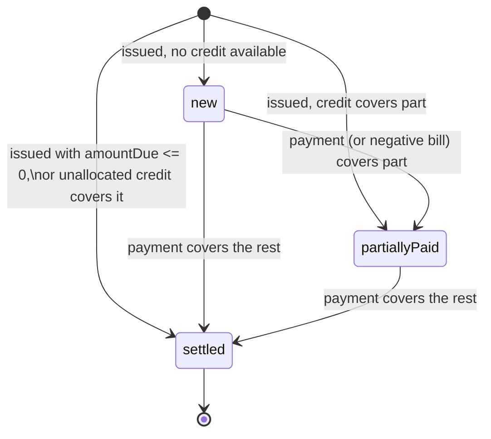
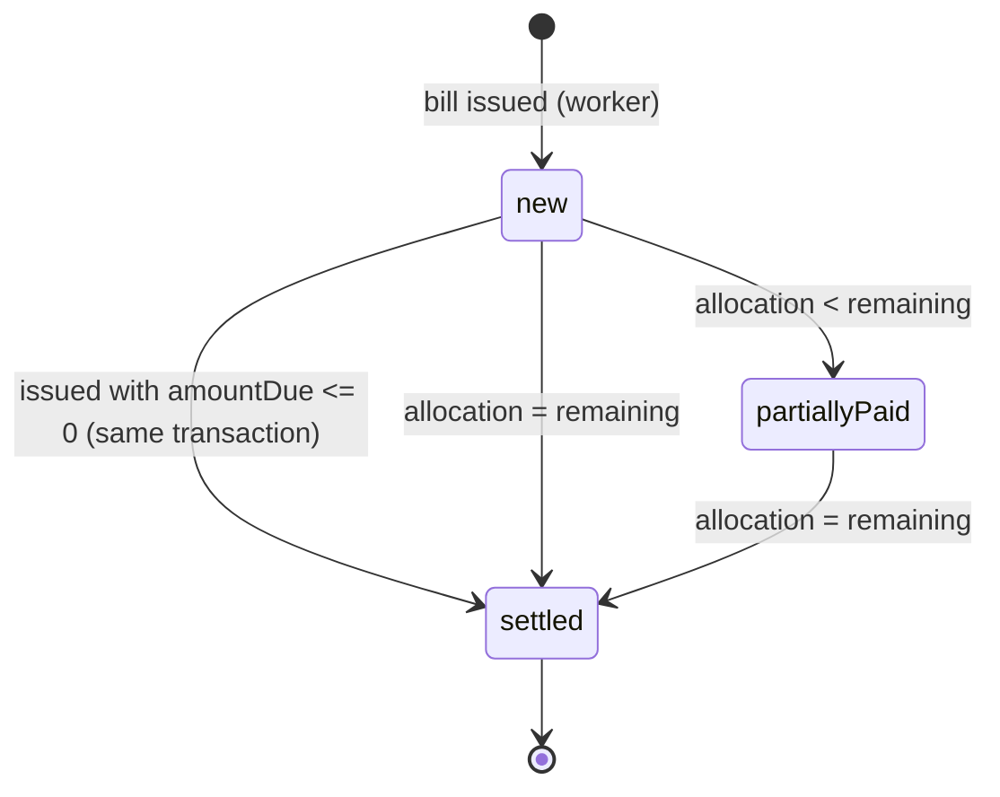

# Bill lifecycle: design proposal

Status: **proposal, for decision** (2026-10-10, branch `cloud/bill-lifecycle-design`).
Nothing here is implemented. Written against `master` at `209955c`.

Problem: every `customerBill` stays in state `new` for ever, and payments never touch a
bill. Payments only move the account balance. This document records what the code does
today (section 1), the TMF678 state model (2), three options (3), edge cases (4), and a
recommendation with the questions you need to answer (5).

Citations are `path:line` at `209955c`.

---

## 1. Current state

### 1.1 How bills are created

- **Only the billing run writes bills.** The worker's `DateRun.step()` calls
  `bill_account(conn, account_id, run)` once per member account and date
  (`app/worker/process.py:134`). `bill_account` locks the billing account row
  (`app/repository/billing.py:570`, `SELECT ... FOR UPDATE`), loads the state, runs the
  pure core and writes the result in one transaction (`app/billing/adapter.py:52-64`).
- **Bill day and period.** The core's `_bills` (`app/billing/core.py:234-272`) issues one
  bill per cycle day D after the account's last bill, up to the run date (`as_of`). It
  covers `[D, same day next month)` (`core.py:261-266`). The module docstring says the
  same (`core.py:10-12`).
- **Which ABRs.** A bill on D collects every **unbilled** ABR whose **run date** is <= D
  (`core.py:238-259`; the `take` filter is at `core.py:258`). ABRs written in the run of D
  go onto the bill of D. A product that starts mid-cycle is charged in advance on its start
  date, but that charge goes onto the **next** bill:
  `test_mid_cycle_start_goes_onto_the_next_bill`, `tests/test_billing_core.py:216`
  (164.52 charged on Oct 15, billed on Nov 1 together with Nov's 300.00 = 464.52).
- **Empty vs zero.** A cycle day with nothing to collect gets no bill. A bill whose ABRs
  sum to 0.00 is still issued:
  `test_empty_bills_are_skipped_and_zero_bills_are_not`, `tests/test_billing_core.py:232`.
- **Negative bills.** `amount_due` is the plain sum of the collected ABRs. Refund ABRs are
  negative (`alembic/versions/0001_initial_schema.py`, constraint `abr_refund_amount`), so
  a bill can be negative: `test_bill_may_be_negative`, `tests/test_billing_core.py:223`
  (-116.13). The column comment says so too: "may be negative"
  (`alembic/versions/0005_schema_comments.py:289`).
- **Missed cycle day.** A run whose `as_of` is past a cycle day that has no bill yet
  issues the bill for that day, with what was known by then:
  `test_missed_cycle_day_is_billed_with_what_was_known_by_then`,
  `tests/test_billing_core.py:240`. In production the worker replays missed dates in
  order, each with its own run, so the bill of D is written by the run of D, even when
  that run executes days later. `test_replay_after_an_outage_gives_the_same_rows_and_bills_as_daily_runs`,
  `tests/test_billing_db.py:285`, proves this.
- **Every bill collects every ABR exactly once**: property
  `test_bills_collect_every_abr_exactly_once`, `tests/test_billing_properties.py:278`.
- **Schema** (`alembic/versions/0001_initial_schema.py:326-342`): `customer_bill`
  (`billing_account_id`, `currency`, `bill_period daterange`, `bill_date`,
  `state customer_bill_state_type NOT NULL`, `amount_due numeric(12,2)`,
  `billing_run_id`). Bills of one account never overlap (`customer_bill_no_overlap`). An
  ABR points at its bill through `customer_bill_id` (NULL = unbilled).
- **State is written once, as `new`.** `insert_bill(..., state: str = "new")`
  (`app/repository/billing.py:462-490`, default at `:471`). `write_bill` never passes a
  state (`billing.py:697-706`). Nothing in `app/` or `tests/` ever runs
  `UPDATE customer_bill` (grep finds none). The column comment says "bills are written as
  new" (`0005_schema_comments.py:288`).

### 1.2 What TMF678 exposes today

`app/api/bill.py`, read-only.

- Routes: `GET /customerBill`, `GET /customerBill/{id}`, plus the ABR pair
  (`app/api/bill.py:99-155`). POST and PATCH return 405:
  `test_bills_and_rates_are_read_only`, `tests/test_api_inventory_bill.py:180`.
- Attributes (`bill.py:28-35`, body at `:58-69`): `id`, `href`, `billDate`,
  `billingPeriod`, `amountDue`, `state` (the stored column, `:65`), `billingAccount`,
  `lastUpdate`, `@type: CustomerBill`.
- **Not exposed**: `remainingAmount`, `paymentDueDate`, `appliedPayment[]`, `billNo`,
  `category`, `runType`, `taxExcludedAmount`/`taxIncludedAmount`, `nextBillDate`.
- Filters: `billingAccount.id`, `state` (`bill.py:103-107`).
- The test checks `state == "new"` and that `?state=sent` returns nothing:
  `test_customer_bill_and_is_billed`, `tests/test_api_inventory_bill.py:132-168`
  (asserts at `:152` and `:168`).
- The DB enum holds all six TMF values (`0001_initial_schema.py:80-89`), and
  `tests/test_enum_lock.py:27` locks it against the spec.

### 1.3 How TMF676 payments are stored

- Table `payment` (`0001_initial_schema.py:383-393`, plus `payment_method` from
  `0002_tmf_api_columns.py:64`): `billing_account_id`, `currency` (composite FK to the
  account's currency), `amount > 0`, `received_at`, `status` (enum with the single value
  `done`, `0001:97`). There is no link to a bill.
- `POST /payment` (`app/api/payment.py:120-146`) records a payment that has already been
  received: `status` `done`, `paymentDate` = `statusDate` = the injected clock
  (`:138`), `totalAmount` > 0 (`:59`), in the account's currency. It takes **no lock**
  on the account. Test: `test_payment_is_recorded_as_done`,
  `tests/test_api_payment.py:20`.
- `paymentItem` (TMF676's link from a payment to bills) is not modelled. As an unknown
  attribute it would be a 400. The same rule is proven for `description` in
  `test_invalid_payments_are_rejected`, `tests/test_api_payment.py:88` (case at `:84`).
- Payments are never changed or deleted (405): `test_payments_cannot_be_changed`,
  `tests/test_api_payment.py:142`.

### 1.4 Balance and credit limit

- **Balance = payments (`done`) - sum of all ABRs, billed or not**
  (`app/repository/billing.py:493-511`). Positive means the customer is in credit. It is
  exposed as TMF666 `accountBalance[currentBalance]` (`app/api/account.py:168-174`).
  Test: `test_balance_includes_charges`, `tests/test_api_inventory_bill.py:171` (a
  100.00 charge gives -100.00).
- So **bills play no part in the balance**. An ABR moves the balance the day it is
  written, which is weeks before its bill in the mid-cycle case. Bills only group ABRs.
- `creditLimit` is informational only. It is shown, and `firstCharge` computes
  `exceedsCreditLimit = after < -limit` (`app/internal/accounts.py:142-170`). Nothing is
  refused because of it (CLAUDE.md, "creditLimit").
- The internal `transactions` ledger (`app/repository/billing.py:756-808`,
  `app/internal/accounts.py:274`) lists charges, refunds and payments with
  `balanceAfter`. Bills do not appear in it.

### 1.5 What the UI shows

- **No screen shows bills.** The subscriber card (`frontend/src/screens/SubscriberCard.tsx`)
  has a Billing account panel (`:219-262`: Balance with an "In arrears" caption when
  negative, Currency, Cycle day + next cycle date, Credit limit, Available incl. credit),
  then Charge history (ABRs: date, period, days, amount, `:36-41`, `:392-417`) and
  Transaction history (`:42-47`, `:418-440`). The internal `charges` endpoint returns a
  `bill` link per ABR (`spec/internal/bss-internal.oas.yaml:465`), but the UI does not
  render it (`CHARGE_COLUMNS`, `SubscriberCard.tsx:36-41`).
- The subscribers list shows the balance and counts negative balances
  (`frontend/src/screens/Subscribers.tsx:51`, `:82`).
- **The UI cannot record a payment.** Payments come only from TMF676 `POST /payment` and
  from the seed (`tests/seed.py:228-267`).

---

## 2. The TMF678 state model

From `spec/TMF678-CustomerBill-v5.0.0.oas.yaml:1753-1765`, `CustomerBillStateType`:

```
new | onHold | validated | sent | settled | partiallyPaid
```

The spec calls it a "Recommended Enumeration Type (not formal forced in standard)" and
gives these meanings: new = ready to validate or to send; validated = checked (manually or
automatically); sent = sent through the channel defined in the billing account; settled =
paid; onHold = no further processing until open issues are solved. **The description says
`partiallySettled`, but the enum value is `partiallyPaid`.** The enum is authoritative,
and `test_enum_lock.py` already compares against it.

The spec defines no transitions. It also has **no overdue, unpaid, written-off or
cancelled state**. Payment status and document status share one field.

Related spec fields:

- `CustomerBill` (`:1459` ff.): `remainingAmount` (Money), `paymentDueDate`
  (date-time), `appliedPayment[]` of `AppliedPayment {appliedAmount: Money, payment:
  PaymentRef}` (`:708-717`; "the result of lettering ... automatically or manually"; "an
  n:m relation between payment and bill"), `billNo`, `category` (free text, e.g. "credit
  note"), `runType` (`onCycle`/`offCycle`), `taxExcludedAmount`/`taxIncludedAmount`.
- `PATCH /customerBill/{id}` exists in the spec (`:248`). Its body is `CustomerBill_MVO`
  (`:1854-1870`), which allows **only `state` and `billCycle`**. In the spec, state is the
  one thing a client may change on a bill.
- TMF676 v4 (`spec/TMF676-Payment-v4.0.0.swagger.json`): `Payment.paymentItem[]` of
  `PaymentItem {item: EntityRef (required), amount, totalAmount, taxAmount}` (`:1499`
  ff.). It is the payment-side view of the same lettering. `PaymentStatusExampleType`
  (`:1738`) includes `done`. A separate `/refund` resource (`:1751`) pays money back to a
  customer. That TMF676 refund has nothing to do with our refund ABRs (credits on a bill).

### Which states make sense here

| State | Use in this demo |
|---|---|
| `new` | Issued, nothing paid yet. **Yes.** |
| `partiallyPaid` | Some, but not all, of `amountDue` is covered. **Yes.** |
| `settled` | Fully covered, or nothing was due (`amountDue <= 0`). **Yes.** |
| `validated`, `sent` | No validation step, bill document or delivery channel exists. They would be cosmetic. **Not now** (only option C). |
| `onHold` | Disputes. Useful only once someone can take a bill out of automatic settlement. **Not now** (only option C). |

"Overdue" is not a TMF state. If wanted, it is a derived flag:
`paymentDueDate < business date AND remainingAmount > 0`. It is not a state value.

---

## 3. Options

All three keep these unchanged:

- **The balance.** It stays payments - all ABRs. Bills still do not define it. Section
  3.0 explains how the two relate.
- **The pure billing core.** Settlement is a separate pure function. `compute()` is not
  touched.
- **Payments are append-only.**
- **Allocation is oldest-first.** Credit goes to the bill with the earliest `billDate`
  first. A newer bill is never partly paid while an older one is still open.

### 3.0 The rule all options share (settlement arithmetic)

For one account:

- *Positive bills*, ordered by `bill_date`, with amounts a1, a2, ... and cumulative dues
  `cum_k = a1 + ... + ak`.
- *Credits*: every `done` payment, plus `|amountDue|` of every negative bill.
  `C` = their total.
- Bill k: `remaining_k = min(a_k, max(0, cum_k - C))`. Its state is `settled` if
  `remaining_k = 0`, `new` if `remaining_k = a_k`, else `partiallyPaid`. A bill with
  `amountDue <= 0` is `settled` from the moment it is issued, with `remainingAmount` 0.
- *Unallocated credit* = `max(0, C - sum(a))`.

**Invariant linking bills and balance** (the main test oracle):

```
sum(remainingAmount of all bills) - unallocatedCredit = -(accountBalance + unbilledABRs)
```

Here `unbilledABRs` is the sum of ABRs with `customer_bill_id IS NULL`. In words: what the
customer owes on bills, minus credit not yet used, equals what they owe overall, minus
charges not yet billed.

Worked example (the mid-cycle case of `tests/test_billing_core.py:216`; cycle day 1,
300.00/month, product from Oct 15):

| Day | Event | Balance | Unbilled | Nov 1 bill (464.52) | Unallocated |
|---|---|---|---|---|---|
| Oct 15 | charge 164.52 | -164.52 | 164.52 | - | 0 |
| Oct 20 | payment 200.00 | 35.48 | 164.52 | - | 200.00 |
| Nov 1 | charge 300.00, bill 464.52 | -264.52 | 0 | `partiallyPaid`, remaining 264.52 | 0 |
| Nov 5 | payment 264.52 | 0.00 | 0 | `settled` | 0 |

Every row satisfies the invariant (for Oct 20: 0 - 200.00 = -(35.48 + 164.52)).

Two consequences:

- **The UI must show "due on bills" next to the balance.** On Oct 20 the balance is
  positive while 164.52 is already charged but not yet billed.
- **`creditLimit` is unaffected.** It stays a warning on the balance.

---

### Option A: derived settlement (computed on read, nothing stored)

`state`, `remainingAmount` and `appliedPayment` are **computed from the payments and
bills at read time**, with the arithmetic of 3.0. This follows the same approach as "No
balance column".



A bill never moves backwards. Credits only grow, and a new bill always comes after the
existing ones in `bill_date` order, so it cannot take credit already used by an older
bill. This is a property to test.

- **Triggers:** none. The state follows from the data. A `POST /payment` shows up on the
  next read, immediately. The worker does nothing new apart from writing the due date
  below.
- **Allocation:** oldest first, implicit. `appliedPayment[]` is derived by overlapping
  intervals: payment j covers the credit interval `[C_(j-1), C_j)`, bill k the due
  interval `[cum_(k-1), cum_k)`, and the overlap is `appliedAmount`. Credits are ordered
  by `received_at` for payments and by `bill_date` for negative bills. Explicit allocation
  is **impossible** in this option.
- **Partial payments:** `partiallyPaid` with `remainingAmount`.
- **Overpayment / credit:** stays unallocated and settles the next bill when it is issued.
  That bill appears as `settled` (or `partiallyPaid`) from its first read.
- **Refunds (expected - charged):** refund ABRs land on the next bill and lower its
  `amountDue`. If the bill goes negative, its absolute value becomes credit for older open
  bills, or stays unallocated.
- **accountBalance:** unchanged.
- **API:**
  - TMF678 `customerBill` adds `remainingAmount`, `appliedPayment[]` (`PaymentRef` with
    `id`, `href`, `@referredType: Payment`), `paymentDueDate`, and optionally `billNo`
    (display id `BL-xxxxxxxx`), `runType: onCycle`, `category: creditNote` for negative
    bills.
  - `state` becomes derived. The `state=` filter must filter on the derived value (an SQL
    view with window sums, below). `lastUpdate` does not move when the derived state
    changes (only the row's `updated_at` would), which is a small deviation to document.
  - TMF676: no change to POST. `paymentItem` stays a 400. The response could optionally
    carry the derived `paymentItem[]`.
  - Internal API: none needed. The UI reads TMF678 directly, and "overdue" is computed in
    the UI from `paymentDueDate` and the context's business date.
- **UI:**
  - A **Bills** panel on the subscriber card: bill no., bill date, period, amount due,
    remaining, due date, state pill (reusing token colours), and "overdue" in red when
    past due.
  - The Billing account panel gets an "Outstanding on bills" KPI next to Balance.
  - Optional: a **Record payment** dialog (TMF676 POST), so the lifecycle can be
    demonstrated from the UI.
  - New `data-ui` markers mean new `scope.yaml` items, which need your approval.
- **Migration 0006:**
  - Add `payment_due_date date`, back-filled with `bill_date + N` and then set NOT NULL.
  - Either drop `customer_bill.state`, or keep it with its comment changed to "unused;
    derived". **Dropping is cleaner**: a stored `new` that is wrong would mislead anyone
    reading the table. The enum type can stay, because the lock test reads `pg_enum`.
  - Add a view, `customer_bill_settlement`: cumulative sums per account via window
    functions, giving `remaining` and `state` per bill.
- **Worker:** the adapter writes `payment_due_date` when it writes a bill
  (`app/billing/adapter.py:42-49` → `write_bill`). Nothing else.
- **Tests:**
  - A pure `app/billing/settlement.py` with hypothesis properties: states never regress
    when payments or bills are appended; `0 <= remaining <= amount`; at most one
    `partiallyPaid` bill per account, with all older bills settled; `sum(appliedAmount)
    = amountDue - remaining`; and the invariant of 3.0 against the ledger in
    `tests/billing_sim.py`.
  - A DB test that the SQL view equals the Python function on random data.
  - API contract tests (`tests/apiclient.py` validates the new fields against TMF678).
  - vitest with `expectUi`, and the e2e on seeded data (the seed's payments already give
    `settled` and `partiallyPaid` bills).
  - Negative proofs: allocate newest-first; ignore negative bills; count unbilled refunds
    as credit; settle `amountDue = 0` as `new`. Each must make a test fail.
- **Effort: S-M**, one slice. No new writer and no concurrency. The only migration is a
  column plus a view.
- **Limits:**
  - No explicit allocation and no `onHold`. Both break the "pure function of the data"
    property, so either one means moving to B.
  - No stored settlement time. It can be derived as the `received_at` of the payment that
    crossed `cum_k`.

### Option B: stored allocations, automatic oldest-first (TMF lettering)

A new table records every allocation. `customer_bill.state` is **stored and kept
current** in the same transaction as the allocation.



Allocations happen in `settle(conn, account_id, now)`, which takes the oldest unallocated
credit and puts it on the oldest open bill until one side runs out. It runs:

1. **in `POST /payment`**: lock the billing account `FOR UPDATE` (the same lock
   `bill_account` takes), insert the payment, settle;
2. **in `bill_account`**, after the bills are written (`apply_result`): a new bill uses
   up unallocated credit, and a negative bill adds credit;
3. **in every run, for every account.** That makes it self-repairing, and it back-fills
   all existing bills on the first run after the deploy. No data migration is needed.

- **Sub-variant B′, end-of-day settlement:** skip trigger 1. Only the run settles, using
  payments received before 00:00 of its run date, the same visibility rule as orders
  (`app/billing/adapter.py:21-25`). Replays are then fully identical, at the cost of bill
  states lagging up to one day behind a payment. **B (immediate) suits a demo better.**
- **Allocation:** oldest first, automatic. The per-bill totals equal option A's at all
  times; A's function becomes the test oracle for B.
  - *Optional slice B2, explicit lettering:* accept TMF676 `paymentItem[]` with
    `item = {id, @referredType: CustomerBill}` and `amount`. The 422 cases: a bill of
    another account, an amount above the bill's remaining amount, a sum above
    `totalAmount`. Whatever is not lettered goes oldest-first. A bill paid explicitly out
    of order makes "at most one `partiallyPaid`" false, so that property is dropped in B2.
- **Partial payments, overpayment and refunds:** as in A. Unallocated credit is
  `payments + negative bills - allocations`. When a negative bill is written, its credit
  is allocated like a payment's (allocation row with `credit_bill_id`).
- **accountBalance:** unchanged.
- **API:**
  - TMF678 as in A, but `state` is the stored column and `appliedPayment[]` comes from the
    table. `lastUpdate` moves when the state changes (`set_updated_at` trigger).
  - TMF676: optional derived `paymentItem[]` in the response, plus the B2 request above.
  - Internal API: optionally `unallocatedCredit` per account (or the UI computes it from
    the invariant).
- **UI:** as in A.
- **Migration 0006:**
  - Table `bill_allocation`: `id`, `billing_account_id`, `customer_bill_id`, `payment_id`
    or `credit_bill_id` (CHECK exactly one), `amount > 0 numeric(12,2)`, `currency`,
    `allocated_at` (injected clock), and composite FKs to bill, account and payment
    (adds `UNIQUE (id, billing_account_id)` on `payment`).
  - `payment_due_date` as in A.
  - "Allocated <= amountDue per bill" and "allocated <= amount per payment" cannot be a
    CHECK. They are enforced in `settle` and tested, or with a deferred constraint
    trigger if you want them in the database.
- **Worker:** `settle` inside `bill_account`'s transaction (after `apply_result`) and for
  every member account. It stays idempotent: nothing to allocate means nothing is
  written.
- **Rule change:** "only the billing run writes bills" becomes "only the billing run
  *creates* bills; settlement (the API and the run) changes their state". CLAUDE.md needs
  updating.
- **Tests:**
  - Everything listed for A, plus: the stored states equal A's pure function after any
    random sequence of payments and runs (hypothesis over `billing_sim`).
  - Concurrency, with two connections in the style of `tests/test_billing_db.py:168`: a
    payment and a run on the same account serialize on the account lock, and no credit is
    allocated twice.
  - Back-fill: bills issued before the migration settle on the first run.
  - B2: the 422 cases, and the lettering appears in both `appliedPayment` and
    `paymentItem`.
  - Negative proofs: no lock in `POST /payment`; allocation without the `FOR UPDATE`;
    newest-first.
- **Effort: M** (B), **+S** for B2. One new writer path in the API, one table, and one
  concurrency proof.

### Option C: full document lifecycle (B + validated/sent/onHold + due-date processing)

Option B, plus the TMF states that describe the bill as a document.

```mermaid
stateDiagram-v2
    [*] --> new: issued (worker)
    new --> validated: worker, same run (automatic check)
    validated --> sent: worker, same run (no channel: "made available")
    sent --> partiallyPaid: allocation < remaining
    sent --> settled: allocation = remaining, or amountDue <= 0
    partiallyPaid --> settled: allocation = remaining
    sent --> onHold: PATCH state=onHold (dispute)
    partiallyPaid --> onHold: PATCH state=onHold
    onHold --> sent: PATCH state=sent (released; nothing allocated yet)
    onHold --> partiallyPaid: PATCH state=sent (released; part allocated)
    settled --> [*]
```



- **Triggers:**
  - The worker moves new → validated → sent in the same run.
  - Allocation as in B.
  - **`PATCH /customerBill/{id}`** (`application/merge-patch+json`, `state` only, as
    `CustomerBill_MVO` allows) puts a bill on hold or releases it. Any other transition
    is a 409, following the pattern of `_check_lifecycle` in `app/api/catalog.py`.
- **Allocation:** oldest-first, **skipping `onHold` bills**. Credit that arrives while a
  bill is on hold goes to newer bills or stays unallocated. Releasing a bill triggers a
  `settle`.
- **Due date via the worker:** each run flags bills past `paymentDueDate` that still
  have money remaining. TMF has no overdue state, so this is an internal flag or a list,
  for dunning. Any *consequence*, such as suspending the account, depends on the open
  question "Suspension semantics" in CLAUDE.md and is **not** part of this option.
- **API:** as in B, plus TMF678 PATCH (it is 405 today:
  `tests/test_api_inventory_bill.py:180` would change) and possibly an internal
  `GET /bills?overdue=true`.
- **UI:** as in B, plus Put on hold / Release in a bill dialog, a "Disputed" pill, and an
  overdue filter on the subscribers list.
- **Migration:** as in B, plus nothing for states (the enum already has them).
- **Worker:** the issue-time transitions; the overdue pass.
- **Tests:** as in B, plus a transition table test (every pair of states x every
  trigger), on-hold skipping in allocation, and release re-settling. Negative proofs for
  each forbidden transition.
- **Effort: L**, 3-4 slices. `validated`/`sent` add states that carry no meaning here
  (there is no document and no channel), so they are mostly ceremony in this demo.

### Comparison

| | A derived | B stored allocation | C full lifecycle |
|---|---|---|---|
| States used | new, partiallyPaid, settled | same | all six |
| New writer | none | `POST /payment`, run | + PATCH, worker passes |
| Explicit allocation (`paymentItem`) | no | B2 | yes |
| Disputes (`onHold`) | no | no | yes |
| Replay-identical | yes | B′ only | B′ only |
| Concurrency risk | none | payment vs run (lock) | same |
| Migration | column + view (+ drop `state`) | table + column | same as B |
| Effort | S-M | M (+S for B2) | L |

---

## 4. Edge cases

| Case | A | B | C |
|---|---|---|---|
| **Payment before the first bill** | Unallocated credit. The first bill reads `settled` or `partiallyPaid` from its first read. | Payment stored without allocation. The run that issues the first bill allocates it in the same transaction, so the bill is never visible as `new` if credit covers it. | As B. The bill goes new → validated → sent → settled in one run. |
| **Payment larger than all open bills** | Open bills `settled`; the rest is unallocated credit (balance positive) and settles later bills. No payout: a TMF676 `/refund` is out of scope. | Same. The payment has allocations below its amount; the remainder is used by later bills. | Same. |
| **Bill with zero amount** (`tests/test_billing_core.py:232`) | `settled` at issue, `remainingAmount` 0, no `appliedPayment`. | Written `new` then set to `settled` in the same transaction (or inserted as `settled` directly). | `settled` directly after sent. |
| **Refund producing a negative bill** (`tests/test_billing_core.py:223`) | `settled`, remaining 0, `amountDue` stays negative; optionally `category: creditNote`. Its absolute value is credit for older open bills, then for later ones. | Same; allocation rows carry `credit_bill_id`. | Same. A negative bill cannot be put on hold (409). |
| **Bill issued during catch-up for an old date** | `billDate` is in the past. If `paymentDueDate = billDate + N` and the catch-up is more than N days late, the bill is overdue the moment it appears. All credit known at read time applies, including payments received after `billDate`. Final per-bill totals are order-independent. **Pairings** (which payment paid which bill) can shift when a negative bill for an old date arrives after newer payments. | Same totals; settled with all payments known when the catch-up run executes (B) or only those before 00:00 of the replayed date (B′, identical to the daily history). | As B. The overdue pass must not dun a bill whose due date passed before it existed. |
| **Payment and run at the same moment** | No writes, no race. | Both lock the account row. The second waits and then sees the first's allocations. | As B. |
| **A missing price makes the account fail in a run** | Not affected. | The run's `settle` for that account is rolled back with the account (`BillingError`); `POST /payment` still settles. | As B. |

On the due date for catch-up bills, two choices:

- **(i) `billDate + N`.** Deterministic and replay-identical, but a bill issued very late
  is overdue at once.
- **(ii) `max(billDate, issue date) + N`.** The issue date is the business date of the
  issuing run's attempt, which uses the injected clock (`billing_run.started_at` is reset
  on a reopen or takeover, so it must be captured at write time). Fairer to the customer,
  but the replay test then has to exclude `payment_due_date`.

---

## 5. Recommendation and open questions

**Recommendation: option A now, built so that B can replace it without visible change.**

- It fixes the visible problem (bills progress; `remainingAmount`, `appliedPayment`,
  `paymentDueDate` are exposed) in one slice, with no new writer and no concurrency.
- It follows the project's existing approach: computed rather than stored (as the
  balance), replay-identical, pure function plus property tests.
- Its pure settlement function is exactly the oracle B needs. If explicit lettering
  (B2) or disputes (C) ever matter, B swaps the storage, and the API output stays
  identical by test.
- C's `validated`/`sent` describe a bill document and a delivery channel that do not
  exist here. They would be states without meaning.

Proposed order for A:

1. Pure `settlement.py` with properties and negative proofs.
2. Migration 0006 (due date, view, `state` column decision).
3. TMF678 fields and the derived `state` filter.
4. The UI Bills panel and the "Outstanding on bills" KPI (plus Record payment if you
   want it).
5. `scope.yaml` items (your approval), `make progress`, CLAUDE.md.

**Questions for you:**

1. **Option:** A, B (with or without B2, B vs B′), or C?
2. **Payment term N** (days from bill date to `paymentDueDate`): 14? 10? And for catch-up
   bills, (i) `billDate + N` or (ii) `max(billDate, issue date) + N`?
3. **Stored `state` column** (A only): drop it, or keep it as an unused column with a
   changed comment?
4. **Negative bills:** credit for *older* open bills as well (proposed), or only for
   later ones? Mark them `category: creditNote`?
5. **Overdue:** only a UI flag (A), or also a worker pass (C)? Should it ever have a
   consequence? That ties to the open question "Suspension semantics".
6. **Paying out credit** (TMF676 `/refund`): out of scope for now? (Proposed: yes.)
7. **Record payment in the UI:** add the dialog in this work, or keep payments API-only?
8. **Extra TMF678 fields:** besides `remainingAmount`, `paymentDueDate` and
   `appliedPayment`, do you want `billNo`, `runType`, `category`?
9. **Derived `paymentItem[]` in TMF676 responses:** yes or no (A and B)?
10. **`scope.yaml`:** new api/ui items (the Bills panel, the Record payment dialog if
    chosen), which need your approval when the slice is built.
