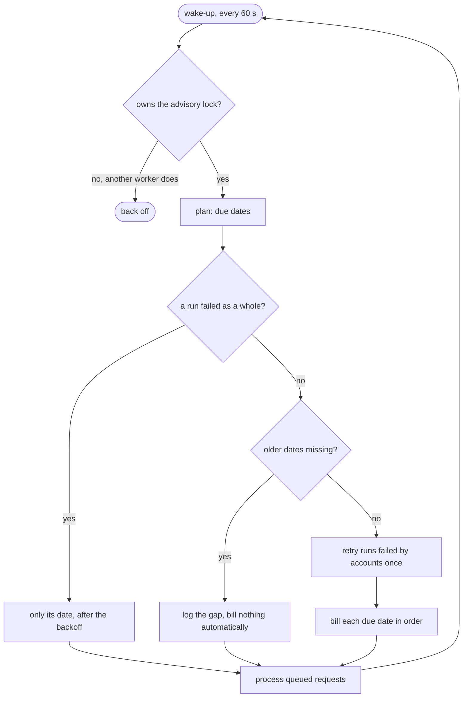

# Billing worker (stage 4)

The worker runs the billing core ([domain.md](domain.md#billing)) once a day, account by
account, survives crashes, reboots and deploys without double-billing, isolates failing
accounts, and carries out the operator's catch-up and retry requests. Code:
`app/worker/`; design: [stage4-design.md](stage4-design.md) (the decisions Q1-Q14 and
D-W*). Every capability below is a `worker.*` item of
[progress/scope.yaml](progress/scope.yaml), proven by tests marked
`@pytest.mark.capability(...)` - 10/10 in [PROGRESS.md](PROGRESS.md).

In production it is the `worker` service of `compose.prod.yaml` (same image as the app,
`python -m app.worker`). Locally there is no long-running worker: `make worker-once` runs
one wake-up.

## The wake-up

The process (`app/worker/__main__.py`) wakes at least every 60 s, re-reads the clock and
does whatever is due - the same decision whether the date just turned, the machine was
suspended or the worker was down. One wake-up (`app/worker/loop.py`, `tick`):

1. **ownership**: if another live worker owns billing, back off;
2. **plan** the dates due on their own (`app/worker/plan.py`, `scheduled`);
3. before a new scheduled date, **retry once** the runs that failed because of accounts
   (D-W17);
4. bill the planned **dates in order**, trigger `scheduled`;
5. carry out the UI's **queued requests**.

## Schedule and due dates

| Rule | Code | Proven by |
|---|---|---|
| The run of date D is due at `BILLING_RUN_AT` (default 00:30, BILLING_TZ), not at 00:00: the margin covers orders that completed before midnight but committed after it (Q5). Before that, only up to yesterday is due | `plan.last_due` | `tests/test_worker_schedule.py::test_the_run_of_a_date_starts_at_0030_not_at_midnight`, `::test_the_clock_is_read_in_billing_tz` |
| The worker refuses to start (exit 2) unless `BILLING_RUN_AT` is strictly between 00:00 and 02:00 (D-W13: after midnight, before the backup and the 03:00 reboot) | `app/worker/runtime.py` (`check_run_at`) | `::test_the_worker_refuses_a_run_time_outside_its_window`, `::test_run_times_inside_the_window`, `tests/test_worker_signals.py::test_the_worker_refuses_to_start` |
| **Automatic window (Q4):** a wake-up bills every date after the latest run up to the due date only if they all lie in the due date and the day before. An older missing date is a **gap**: nothing is billed (billing past it would make it impossible to replay in order) and a warning says "catch up from the admin UI" | `plan.scheduled` | `tests/test_worker_schedule.py::test_what_a_wake_up_bills_on_its_own`, `::test_after_the_reboot_yesterday_and_today_are_caught_up_in_order`, `::test_an_older_gap_is_reported_and_never_billed_silently` |
| First start ever (no run at all): the due date only - its run catches up every earlier period of every product (D-W15) | `plan.scheduled` | `tests/test_worker_schedule.py::test_what_a_wake_up_bills_on_its_own` |
| A run left `running` (its worker was killed or stopped: the reboot, a deploy) is resumed first | `plan.scheduled`, `billing.unfinished_run` | `tests/test_worker_schedule.py::test_a_run_left_running_is_resumed_first`, `::test_a_wake_up_resumes_a_run_left_running` |
| A run that failed as a whole holds the schedule: only its date is tried, after its backoff | `plan.scheduled`, `process.bill_date` | `tests/test_worker_schedule.py::test_a_whole_run_failure_holds_the_schedule_until_its_retry` |
| The test-only clock override `WORKER_FAKE_NOW` is refused unless `APP_ENV=test` (Q14); `APP_ENV` unset means `prod` | `app/worker/runtime.py`, `app/config.py` | `tests/test_worker_runtime.py` |

## Ownership and takeover

One worker owns billing at a time, by a **PostgreSQL session advisory lock** (key
`0x62737301`) taken on the worker's own dedicated connection (`app/worker/db.py`). All the
work runs on that same connection, so **the lock and the work fail together**: a dead
connection frees the lock at the moment the work stops. The connection is autocommit,
with `connect_timeout` 10 s, TCP keepalives 30/10/3 and `lock_timeout` 30 s (W1;
`tests/test_worker_runs.py::test_the_worker_connection_settings`).

`start_run` (`app/worker/runs.py`) takes ownership first (another live owner ->
`RunInProgress`, before anything is read), then the date's `billing_run` row decides:

| Row | Result |
|---|---|
| none | insert a `running` run (`new`) |
| `completed` | nothing to do (`AlreadyCompleted`) |
| `failed` | reopen it: attempt + 1, failure cleared |
| `running` | its owner is gone (we hold the lock): **take it over**, attempt + 1, trigger kept, `started_at` = now (the attempt's start, as on a reopen) |

Proven by `tests/test_worker_runs.py::test_no_run_yet_starts_one`,
`::test_a_completed_run_is_a_noop_not_an_error`, `::test_a_failed_run_is_reopened`,
`::test_a_running_run_whose_owner_is_gone_is_taken_over`,
`::test_a_second_worker_backs_off_and_writes_nothing`, and the failure cases in
`tests/test_worker_failures.py::test_a_takeover_after_a_death_between_accounts`,
`::test_a_dropped_connection_frees_the_lock_for_a_takeover`,
`::test_no_takeover_while_the_owner_is_alive`. A takeover is safe because accounts
already `ok` in the run are never processed again and `bill_account` is idempotent.

## One date, account by account

`DateRun` (`app/worker/process.py`) processes the run's **members** - the accounts opened
before 00:00 of the date (`billing_account.opened_at`, from the injected clock), any
state, in id order (`tests/test_worker_process.py::test_an_account_opened_at_the_run_dates_midnight_is_not_a_member`).
**Per account, one transaction**: its charges and its `billing_run_account` row commit
together or not at all (`::test_charges_and_outcome_commit_together`).

| Outcome | When |
|---|---|
| `ok` | `bill_account` succeeded |
| `failed` (with the error) | `bill_account` raised a `BillingError` (`MissingPrice`, `InconsistentState`); nothing written for the account |
| `blocked` (waits for a run) | the account has an unresolved failure on an earlier date: nothing billed, it waits for that run |

**"Completed" means every member is ok**: otherwise the run closes `failed` with
`failure_kind = accounts` and the error "N of M accounts not billed (...)", and **later
dates go ahead** for the other accounts (`::test_completed_when_every_member_is_ok`,
`::test_not_completed_while_a_member_is_not_ok`,
`::test_a_run_with_a_failed_or_blocked_account_closes_failed`,
`::test_a_failed_account_blocks_only_itself_and_catches_up_in_order`).

## Failure kinds and backoff

| Kind | Cause | Effect |
|---|---|---|
| `accounts` | some accounts failed or are blocked | the run is `failed`; later dates are billed for everyone else; the failed accounts wait for a retry |
| `run` | anything but an account's `BillingError`: the database gone, `LockNotAvailable` (a row lock held past 30 s), a bug | the run is aborted (`RunAborted`) and marked `failed` if the connection still works; a dead worker cannot mark it, so it stays `running` and the next owner takes it over. **No later date is billed** while it is failed (`HeldBack`) |

- The scheduled retry of a run that failed as a whole waits **5 min, then 15 min, then
  hourly** from `finished_at` (`plan.retry_time`; `NotYet` before that). An operator's
  retry or catch-up is not held to the backoff
  (`tests/test_worker_failures.py::test_the_backoff_is_5_15_then_hourly`,
  `::test_a_run_level_error_fails_the_run_and_later_dates_wait`,
  `::test_the_scheduled_retry_waits_for_its_backoff_then_the_dates_go_on`,
  `::test_an_operator_retry_is_not_held_to_the_backoff`, `::test_a_second_failure_waits_longer`).
- `LockNotAvailable` is necessarily run-level: an account's outcome row has a foreign key
  to its `billing_account` row, so recording any outcome for a locked account needs the
  same lock (`::test_a_lock_timeout_is_a_whole_run_failure`).

## Retry rules

`retry_run` (`app/worker/process.py`) retries **only the run's failed accounts** (accounts
blocked on an earlier date stay blocked until that date is fixed). An account that now
succeeds is then billed for its blocked later dates **in order, reopening one run at a
time** (Q2), and stops at the next failure, where its later blocked rows are re-pointed
to wait for that run. The account ends with exactly the rows a run without the failure
would have written (`tests/test_worker_process.py::test_a_failed_account_blocks_only_itself_and_catches_up_in_order`,
`::test_retrying_a_later_run_leaves_accounts_blocked_on_an_earlier_date`,
`::test_a_catch_up_stops_at_the_next_failure_and_later_dates_wait_for_it`,
`::test_only_a_failed_run_can_be_retried`).

Who retries:

- the **schedule**: before a new scheduled date, every run failed because of accounts is
  retried once (D-W17; `tests/test_worker_schedule.py::test_failed_accounts_are_retried_once_before_the_new_date`);
  a run failed as a whole is retried on its date after the backoff;
- the **operator**: `POST /internal/v1/billingRun/{id}/retry` queues a retry of any failed
  run (409 if not failed or already queued).

## Catch-up

`POST /internal/v1/billingRun/catchUp {upTo}` queues a catch-up; **the API never bills**
(`app/internal/billing_runs.py`). `upTo` after the business date, or today before
`BILLING_RUN_AT`, is a 422. The answer names the dates (`plan.catch_up_dates`): a run that
failed as a whole first, then every date after the latest run up to `upTo`, in order; no
run at all -> just `upTo` (D-W15). Nothing due -> 200 `{dates: []}` and nothing queued.
A run that failed because of accounts is not rerun by a catch-up - its accounts come
back through a retry (`tests/test_worker_queue.py::test_catch_up_dates`,
`::test_catch_up_is_refused_before_the_run_is_due`,
`::test_catch_up_queues_a_request_and_says_which_dates`,
`::test_a_catch_up_request_runs_the_dates_in_order`,
`::test_a_catch_up_puts_a_run_failed_as_a_whole_first`).

## Request queue

`worker_request` rows are inserted by the internal API and carried out by the owner
(`app/worker/queue.py`), **oldest first** (`requested_at`, ties broken by insertion
order): mark picked, carry out, mark done.

| Kind | What the worker does |
|---|---|
| `catchUp` | every date of `catch_up_dates` in order with trigger `catchUp`; stops at a whole-run failure |
| `retry` | a run failed because of accounts: `retry_run`; failed as a whole: the date again (trigger `retry`, no backoff); no longer failed: nothing |

A request that raises is still marked done (logged), so one bad request cannot block the
queue; a request picked by a worker that died is picked again; only the owner processes
requests (`tests/test_worker_queue.py::test_a_request_that_raises_is_done_and_does_not_block_the_queue`,
`::test_a_request_picked_by_a_worker_that_died_is_picked_again`,
`::test_only_the_owner_processes_requests`, `::test_a_retry_request_retries_only_the_failed_accounts`,
`::test_a_retry_request_reruns_a_run_failed_as_a_whole`,
`::test_a_retry_of_a_run_fixed_in_the_meantime_does_nothing`).

## Status flips

At the start of each run, in its own transaction, before billing
(`app/worker/process.py`, `flip_statuses`; `app/repository/products.py`):
`created`/`pendingActive` -> `active` once `start_date` <= run date, and
`pendingTerminate` -> `terminated` once `termination_date` <= run date - only for products
whose order (creating, resp. terminating) completed before 00:00 of the run date, blocked
accounts included (statuses follow dates, D-W5); every other status untouched;
idempotent. The due products are locked `ORDER BY id FOR UPDATE` first, like ordering's
locks, so a delete order and the flips only wait for each other (Q8)
(`tests/test_worker_flips.py::test_flips_follow_the_dates`,
`::test_only_orders_completed_before_midnight_count`,
`::test_other_statuses_are_never_touched`, `::test_a_blocked_accounts_products_are_flipped_too`,
`::test_flips_and_a_delete_order_never_deadlock`). The flips are cosmetic for money;
they make TMF637 and the UI show the right status.

## Billing status

`GET /billing-status` (`app/status.py`) is the external monitor's freshness signal,
**unauthenticated** (a Caddy carve-out like `/healthz`), so the body is exactly
`{date, status, ageSeconds}` of the latest run - no amounts, names or counts.

The **expected date** is today once the local time (BILLING_TZ) is past `BILLING_RUN_AT`
+ 2 h grace, else yesterday (D-W19). The latest run decides:

| Latest run | HTTP | `status` |
|---|---|---|
| none at all | 503 | `none` (`date` and `ageSeconds` null) |
| `failed` | 503 | `failed` |
| `running` for less than 2 h since `started_at` | 200 | `running` |
| `running` for 2 h or more, or its date is before the expected date | 503 | `running` |
| `completed`, on or after the expected date | 200 | `ok` |
| `completed`, earlier | 503 | `stale` |

**A takeover restarts the grace.** `started_at` is the start of the current attempt
(first start, reopen or takeover), so a run whose worker died - a deploy, the 03:00
reboot - gets the full 2 h from the takeover, not from the dead worker's start
(`::test_the_grace_of_a_taken_over_run_counts_from_the_takeover`). Because of that, a
worker that keeps dying and being taken over would never let the grace run out; a
`running` run of a date before the expected date is therefore 503 regardless, which
bounds such a loop to about a day (`::test_a_run_taken_over_again_and_again_is_overdue_once_its_date_is_late`).

`ageSeconds` counts from `finished_at`, else `started_at`. It is **not part of
`/healthz`**: a late run never marks the app unhealthy. An unknown query parameter is a
400. Proven by `tests/test_billing_status.py` (all ten tests, including a strict
schema with `additionalProperties: false` on every response).

## Heartbeat and liveness

The liveness file (`WORKER_LIVENESS_FILE`, default `/tmp/worker-alive`) is touched on
every wake-up and **after every account of every path** - scheduled, catch-up and the
retries - through the heartbeat (`DateRun(on_account=...)`), and the run's
`heartbeat_at` is updated after every account. The production healthcheck
(`compose.prod.yaml`) is `find /tmp/worker-alive -mmin -3` in bash (no interpreter start):
older than 180 s or missing -> `unhealthy` after 3 probes, which includes a worker that
cannot reach the database. Healthchecks are informational only: nothing restarts an
unhealthy container. Proven by `tests/test_worker_heartbeat.py` (one heartbeat per
account, no gap over the threshold, in all four paths; without the call all four fail).

## Stopping

- **SIGTERM / SIGINT** (what `docker compose stop`/`up` send): the worker finishes the
  account in hand, leaves the run `running` (not failed), closes its connection - which
  releases the lock - and exits 0 (D-W11). `stop_grace_period: 60s` is far longer than
  one account takes (`tests/test_worker_signals.py::test_sigterm_finishes_the_account_in_hand_and_stops`,
  `tests/test_worker_schedule.py::test_the_checkpoint_stops_between_accounts`).
- **SIGKILL** leaves nothing half-written (one transaction per account), and the next
  worker takes the run over (`tests/test_worker_signals.py::test_sigkill_leaves_nothing_half_written_and_the_next_worker_takes_over`).
  This test found a real bug: the first planner never resumed a run left `running`.
- `--once`: one wake-up, then exit; exit 1 if that wake-up failed
  (`::test_once_bills_the_due_date_and_exits`).

## Operator view

The internal API exposes the runs (`GET /internal/v1/billingRun`, `/{id}`,
`/{id}/accounts?status=`) and accepts catch-up and retry requests
([api/internal.md](api/internal.md)). **The admin UI's Billing runs screen - latest run,
history, failed badge, catch-up and retry buttons - is planned, not built**
(`ui.billingRuns.list`, `ui.billingRuns.catchUp`, `ui.billingRuns.retry`: "no" in
[PROGRESS.md](PROGRESS.md)). Until then the endpoints are called directly.
