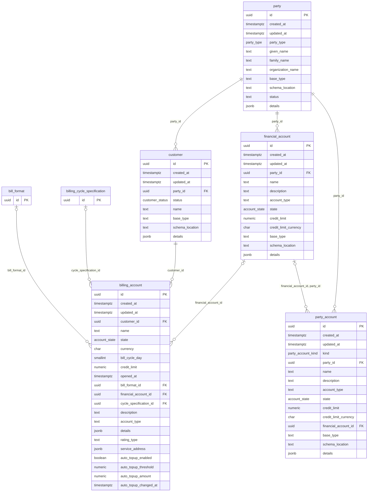
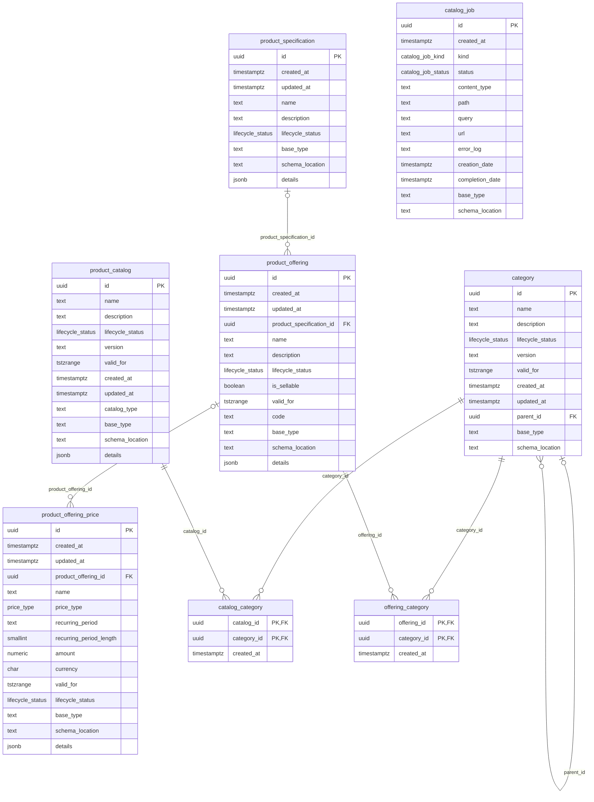
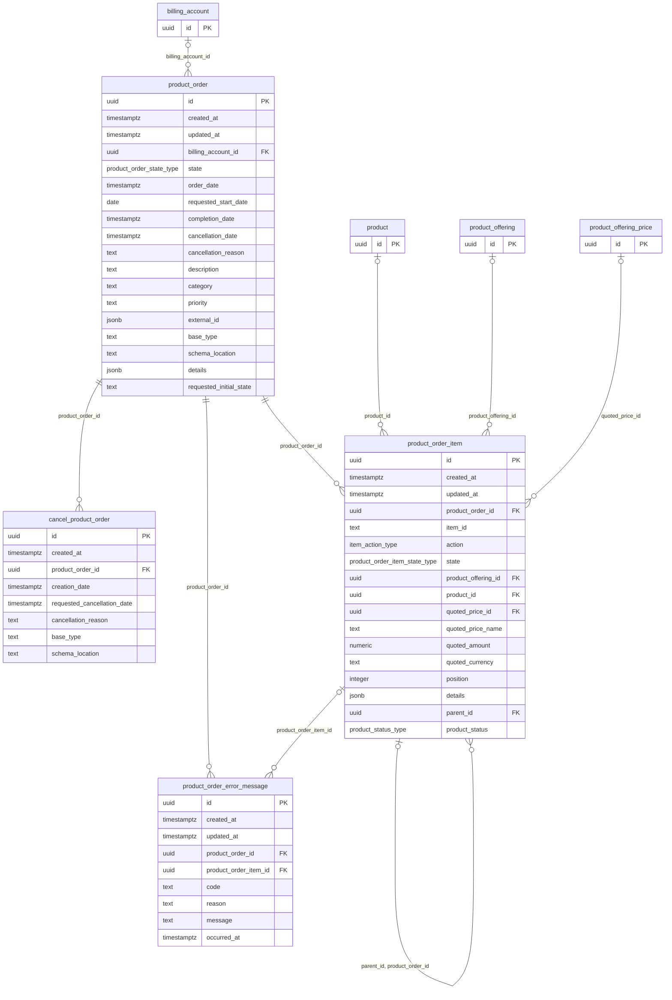
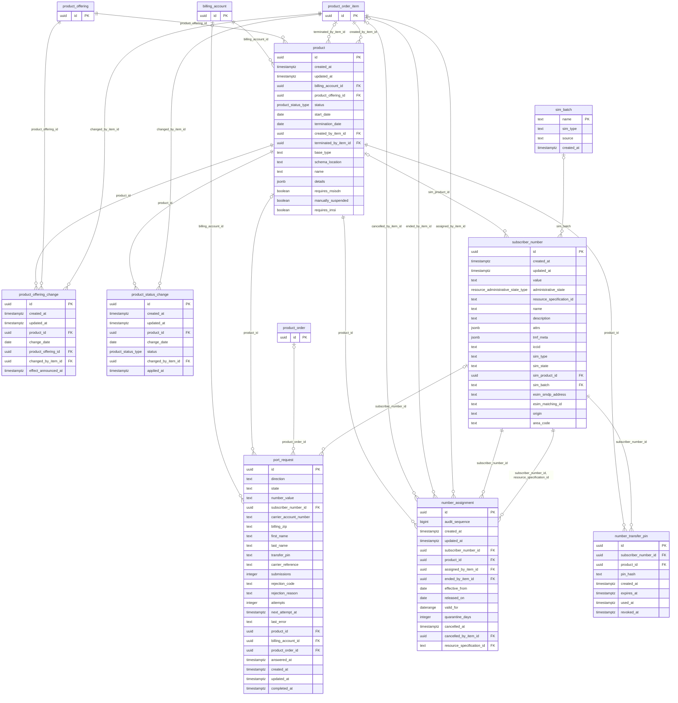
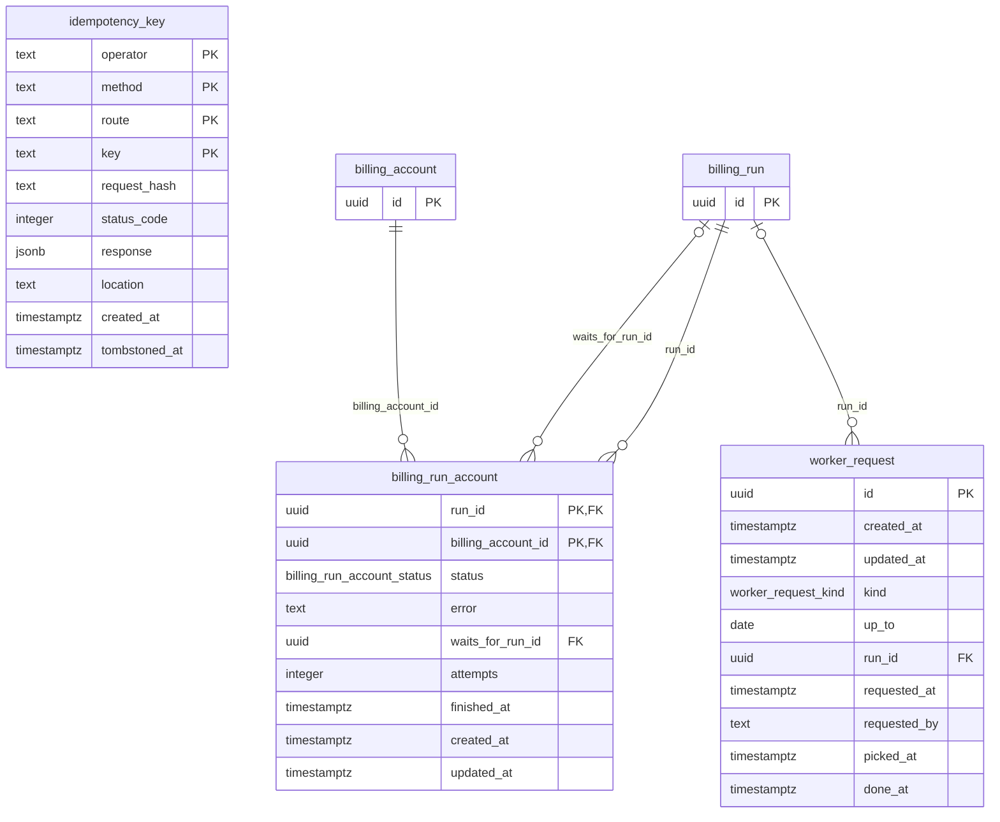
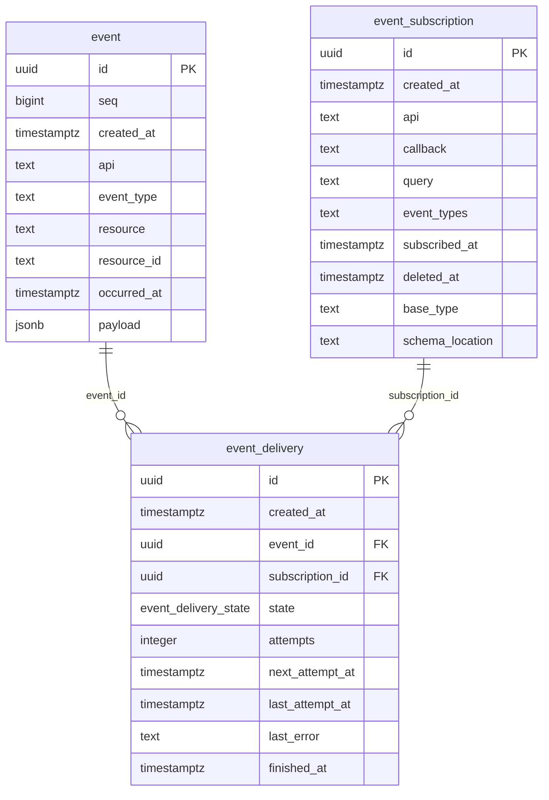
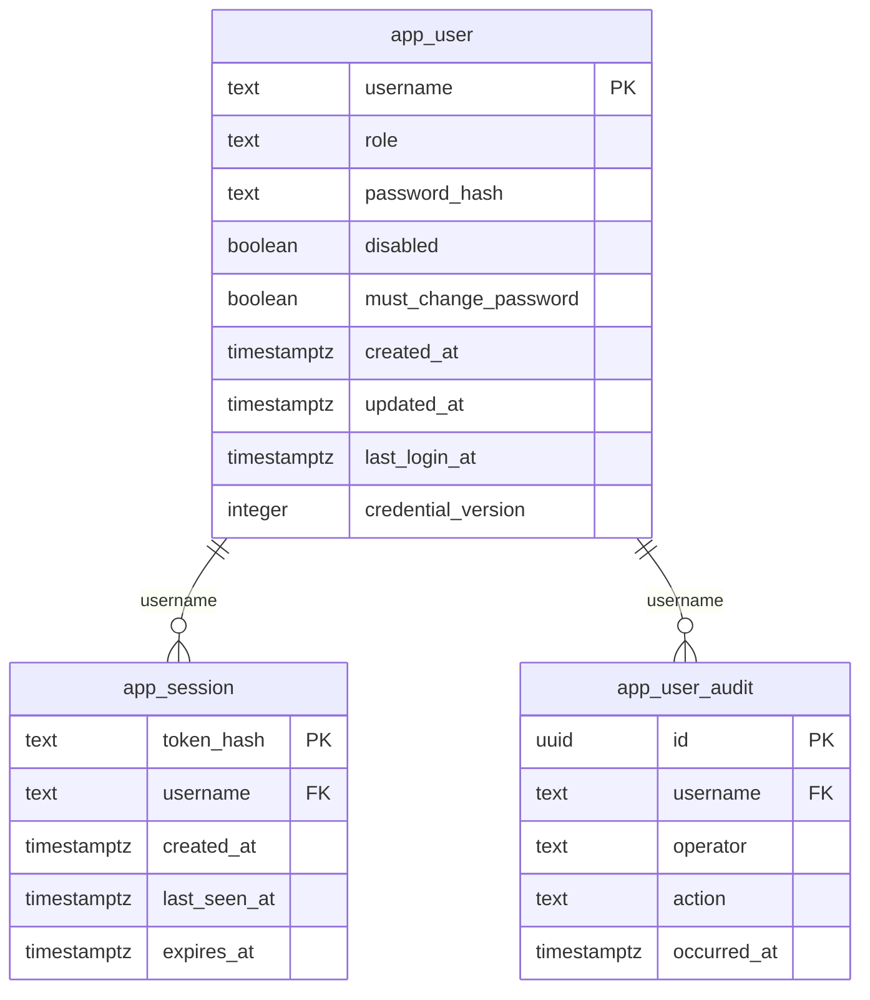

<!-- Generated by `make docs` (scripts/docs/generate.py) - do not edit by hand. -->

# Database reference

PostgreSQL schema at Alembic head **0056**, read from `pg_catalog` of a throwaway database migrated to head (`tests/docs_collect.py`). Descriptions are the tables' and columns' `COMMENT`s (migration `alembic/versions/0005_schema_comments.py`). Migrations live in [`alembic/versions/`](../../alembic/versions/); the schema rules behind them are explained in [domain.md](../domain.md).

| Table | Area | Description |
|---|---|---|
| [`party`](party.md) | party | SID Party (TMF632 individual / organization): a person or an organization, told apart by party_type. |
| [`customer`](customer.md) | party | SID Customer (TMF629 customer): the role a party plays towards us. The party is fixed at creation. |
| [`billing_account`](billing_account.md) | party | SID BillingAccount (TMF666 billingAccount, served as the BssBillingAccount extension): one customer, one currency, one bill cycle day. The balance is not stored: payments (done) minus all ABRs. |
| [`financial_account`](financial_account.md) | party | TMF666 financial accounts: a party's receivables across its billing accounts. |
| [`party_account`](party_account.md) | party | TMF666 party and settlement accounts: records only, no ledger, never billed. |
| [`product_specification`](product_specification.md) | catalog | SID ProductSpecification (TMF620 productSpecification): what a product is, independent of how it is sold. |
| [`product_offering`](product_offering.md) | catalog | SID ProductOffering (TMF620 productOffering): a sellable offer built on one specification. Lifecycle only moves forward: In Design -> Active -> Retired. |
| [`product_offering_price`](product_offering_price.md) | catalog | SID ProductOfferingPrice (TMF620 productOfferingPrice): a price created on its own and attached to at most one offering. Never re-priced, never starts in the past, never ended retroactively; prices of one offering, type and currency never overlap. |
| [`category`](category.md) | catalog | TMF620 catalog organization resource. |
| [`product_catalog`](product_catalog.md) | catalog | TMF620 catalog organization resource. |
| [`catalog_category`](catalog_category.md) | catalog | TMF620 many-to-many category membership. |
| [`offering_category`](offering_category.md) | catalog | TMF620 many-to-many category membership. |
| [`catalog_job`](catalog_job.md) | catalog | TMF620 importJob/exportJob: synchronous, finished on insert; documents as data: URLs. |
| [`product_order`](product_order.md) | ordering | SID ProductOrder (TMF622 productOrder): the only way to create or terminate products. Processed synchronously; a rejected order is stored with its reasons. |
| [`product_order_item`](product_order_item.md) | ordering | SID ProductOrderItem (TMF622 productOrderItem): one add or delete of one product. At most one open delete item per product (partial unique index). |
| [`product_order_error_message`](product_order_error_message.md) | ordering | TMF622 productOrderErrorMessage: why an order was rejected - one row per reason, for the order as a whole or for one item. |
| [`cancel_product_order`](cancel_product_order.md) | ordering | TMF622 cancelProductOrder: done on insert (a refused one is not stored); one per order. |
| [`product`](product.md) | inventory | SID Product (TMF637 product): an instance of an offering on a billing account. Written only by orders; billable on start_date <= d < termination_date. |
| [`product_offering_change`](product_offering_change.md) | inventory | TMF622 modify items: the product's offering from change_date on (billed prorated). The offering on day d is the latest change on or before d, else product.product_offering_id. |
| [`product_status_change`](product_status_change.md) | inventory | TMF622 modify items with product.status: the product is suspended (or active again) from change_date on. Billing does not read it. |
| [`subscriber_number`](subscriber_number.md) | inventory | TMF639 LogicalResource inventory: subscriber identities, built-in msisdn (E.164 digits) and imsi specifications. |
| [`number_assignment`](number_assignment.md) | inventory | Order-owned number claims; half-open business dates, retained cancelled audit versions. |
| [`sim_batch`](sim_batch.md) | inventory | A stocked batch of SIMs or eSIM profiles (one type per batch), imported or generated by the network adapter. |
| [`port_request`](port_request.md) | inventory | A number port: in (the customer brings a number, submitted to the carrier by the billing worker) or out (the carrier reports a request, validated against the Number Transfer PIN). TMF has no porting API: internal API only. |
| [`number_transfer_pin`](number_transfer_pin.md) | inventory | Number Transfer PINs generated on request for a line's number; time-limited and single use. The PIN itself is shown once to the agent and never stored. |
| [`billing_run`](billing_run.md) | billing | Daily runs have one identity per business date; prepaid command runs have one retained identity per command. Only billing runs write ABRs and bills. |
| [`applied_customer_billing_rate`](applied_customer_billing_rate.md) | billing | SID AppliedCustomerBillingRate, ABR (TMF678 appliedCustomerBillingRate): a recurring charge for the billable days of one cycle period, or the one refund of such a charge. Written only by a billing run. |
| [`customer_bill`](customer_bill.md) | billing | SID CustomerBill (TMF678 customerBill): issued on a cycle day, collects every unbilled ABR of the account whose run date is <= the bill date. Bills of one account never overlap. |
| [`payment`](payment.md) | billing | SID Payment (TMF676 v4 payment): money received on a billing account. Never changed or deleted. |
| [`bill_allocation`](bill_allocation.md) | billing | An amount applied to a customer bill (ours; TMF678 appliedPayment, TMF676 paymentItem): from a payment or from the credit of a negative bill, automatic (oldest open bill first) or explicit. Append-only. Bounds: per paid bill <= its amount due, per payment <= its amount, per credit note <= minus its amount due (deferred constraint trigger). |
| [`customer_bill_state_change`](customer_bill_state_change.md) | billing | Every state change of a customer bill (ours), oldest first; the first row of a bill is its issue (from_state NULL). |
| [`refund`](refund.md) | billing | TMF676 recorded refund and its consumed credit. |
| [`refund_source`](refund_source.md) | billing | TMF676 recorded refund and its consumed credit. |
| [`customer_bill_on_demand`](customer_bill_on_demand.md) | billing | Durable TMF678 on-demand request consumed by the billing owner. |
| [`bill_format`](bill_format.md) | billing | TMF666 bill presentation configuration. |
| [`bill_presentation_media`](bill_presentation_media.md) | billing | TMF666 bill presentation configuration. |
| [`account_presentation_media`](account_presentation_media.md) | billing | Account bill delivery preferences; no external delivery is performed. |
| [`billing_cycle_specification`](billing_cycle_specification.md) | billing | TMF666 billingCycleSpecification: named instances of the one monthly policy; billing never reads it. |
| [`prepaid_bucket`](prepaid_bucket.md) | billing | Stable TMF654 bucket and accumulatedBalance identities for one prepaid account/currency. No stored balance; funding ledger is introduced separately. |
| [`funding_hold`](funding_hold.md) | billing | Internal source-pinned funding hold foundation; no public API. |
| [`funding_hold_source`](funding_hold_source.md) | billing | Internal source-pinned funding hold foundation; no public API. |
| [`funding_command_hold`](funding_command_hold.md) | billing | Retained internal command-to-hold retry identity; no public API or worker caller. |
| [`prepaid_command`](prepaid_command.md) | billing | Durable internal prepaid command journal; no runtime dispatcher or public API yet. Request and completed result are retained. |
| [`network_command`](network_command.md) | billing | Durable outbound provisioning command of one prepaid order item; sent by the billing worker through the network adapter, the item completes only when it is confirmed. |
| [`tax_transaction`](tax_transaction.md) | billing | The tax engine transaction behind one prepaid charge (ABR): committed when the charge is booked, voided when the whole charge is credited. |
| [`payment_method`](payment_method.md) | billing | A saved card as a gateway token (TMF670 tokenizedCard). The BSS never receives or stores a card number. |
| [`payment_command`](payment_command.md) | billing | Durable outbound charge to the payment gateway: sent and retried by the billing worker, never inside a request. The balance rises only when the gateway confirms. |
| [`prepaid_funding_shortfall`](prepaid_funding_shortfall.md) | billing | Retained needs-top-up observations; current only while the command is pending. Not technical retry attempts. |
| [`funded_interval`](funded_interval.md) | billing | Immutable prepaid service grants. Persistence foundation only; the future billing owner must atomically post and settle the charge, convert its hold and complete the command. |
| [`funding_hold_conversion`](funding_hold_conversion.md) | billing | Retained internal command hold conversion; no runtime caller. |
| [`funding_conversion_source`](funding_conversion_source.md) | billing | Retained internal command hold conversion; no runtime caller. |
| [`funding_conversion_bill`](funding_conversion_bill.md) | billing | Immutable bill set consuming one command hold atomically; legacy single-bill conversions retain their original target. |
| [`balance_action`](balance_action.md) | billing | TMF654 top-up, reservation, adjustment and transfer actions; balanceActionHistory is their projection. Money and references are immutable; only failed actions may be deleted. |
| [`balance_action_reversal`](balance_action_reversal.md) | billing | Compensating ledger entry of a cancelled top-up or adjustment; at most one per action. |
| [`funding_source`](funding_source.md) | billing | Credit sources beside payments and credit notes: positive adjustments, received transfers and restored debit sources. Bounded with allocations, payouts, holds and consumption. |
| [`funding_consumption`](funding_consumption.md) | billing | Exact source amounts consumed by debits, outgoing transfer principal and credit reversals. |
| [`billing_run_account`](billing_run_account.md) | worker | The outcome of one billing account in one billing run (ours): ok, failed (with the error) or blocked (waiting for an earlier failed run of that account). |
| [`worker_request`](worker_request.md) | worker | The admin UI's queue for the billing worker (ours): catch-up and retry requests. The API only inserts; the worker picks them up oldest first. |
| [`idempotency_key`](idempotency_key.md) | worker | Stored success response of a request carrying an Idempotency-Key, per operator, method and route. |
| [`event_subscription`](event_subscription.md) | events | TMF hub subscriptions of every API; deleted ones are kept (deleted_at) for their deliveries. |
| [`event`](event.md) | events | TMF events some hub wanted, as sent; stored in the transaction of the change. |
| [`event_delivery`](event_delivery.md) | events | One event to one subscription: pending until the worker delivers it or gives up. |
| [`app_user`](app_user.md) | users | Application identity: admin or user (UI), mcp (MCP login only); disabled, never deleted. |
| [`app_session`](app_session.md) | users | Revocable sessions; SHA-256 tokens only, never raw cookies. |
| [`app_user_audit`](app_user_audit.md) | users | Security changes only: operator, target, action and injected clock; no secrets. |

## Overview

Tables grouped by area; an arrow is a foreign key (labelled with its column).

```mermaid
flowchart LR
  subgraph area_party["Party, customer, account (TMF632, TMF629, TMF666)"]
    party[party]
    customer[customer]
    billing_account[billing_account]
    financial_account[financial_account]
    party_account[party_account]
  end
  subgraph area_catalog["Catalog (TMF620)"]
    product_specification[product_specification]
    product_offering[product_offering]
    product_offering_price[product_offering_price]
    category[category]
    product_catalog[product_catalog]
    catalog_category[catalog_category]
    offering_category[offering_category]
    catalog_job[catalog_job]
  end
  subgraph area_ordering["Ordering (TMF622)"]
    product_order[product_order]
    product_order_item[product_order_item]
    product_order_error_message[product_order_error_message]
    cancel_product_order[cancel_product_order]
  end
  subgraph area_inventory["Inventory (TMF637, TMF639)"]
    product[product]
    product_offering_change[product_offering_change]
    product_status_change[product_status_change]
    subscriber_number[subscriber_number]
    number_assignment[number_assignment]
    sim_batch[sim_batch]
    port_request[port_request]
    number_transfer_pin[number_transfer_pin]
  end
  subgraph area_billing["Billing and payments (TMF678, TMF676)"]
    billing_run[billing_run]
    applied_customer_billing_rate[applied_customer_billing_rate]
    customer_bill[customer_bill]
    payment[payment]
    bill_allocation[bill_allocation]
    customer_bill_state_change[customer_bill_state_change]
    refund[refund]
    refund_source[refund_source]
    customer_bill_on_demand[customer_bill_on_demand]
    bill_format[bill_format]
    bill_presentation_media[bill_presentation_media]
    account_presentation_media[account_presentation_media]
    billing_cycle_specification[billing_cycle_specification]
    prepaid_bucket[prepaid_bucket]
    funding_hold[funding_hold]
    funding_hold_source[funding_hold_source]
    funding_command_hold[funding_command_hold]
    prepaid_command[prepaid_command]
    network_command[network_command]
    tax_transaction[tax_transaction]
    payment_method[payment_method]
    payment_command[payment_command]
    prepaid_funding_shortfall[prepaid_funding_shortfall]
    funded_interval[funded_interval]
    funding_hold_conversion[funding_hold_conversion]
    funding_conversion_source[funding_conversion_source]
    funding_conversion_bill[funding_conversion_bill]
    balance_action[balance_action]
    balance_action_reversal[balance_action_reversal]
    funding_source[funding_source]
    funding_consumption[funding_consumption]
  end
  subgraph area_worker["Billing worker (ours)"]
    billing_run_account[billing_run_account]
    worker_request[worker_request]
    idempotency_key[idempotency_key]
  end
  subgraph area_events["Event notifications (TMF hubs)"]
    event_subscription[event_subscription]
    event[event]
    event_delivery[event_delivery]
  end
  subgraph area_users["Application users and sessions (ours)"]
    app_user[app_user]
    app_session[app_session]
    app_user_audit[app_user_audit]
  end
  account_presentation_media -->|"billing_account_id"| billing_account
  account_presentation_media -->|"media_id"| bill_presentation_media
  app_session -->|"username"| app_user
  app_user_audit -->|"username"| app_user
  applied_customer_billing_rate -->|"balance_action_id"| balance_action
  applied_customer_billing_rate -->|"billing_account_id"| billing_account
  applied_customer_billing_rate -->|"billing_run_id"| billing_run
  applied_customer_billing_rate -->|"customer_bill_id, billing_account_id"| customer_bill
  applied_customer_billing_rate -->|"product_id, billing_account_id"| product
  applied_customer_billing_rate -->|"product_offering_id"| product_offering
  applied_customer_billing_rate -->|"refunds_rate_id, product_id"| applied_customer_billing_rate
  balance_action -->|"bucket_id, billing_account_id"| prepaid_bucket
  balance_action -->|"command_id"| prepaid_command
  balance_action -->|"command_id, hold_id"| funding_command_hold
  balance_action -->|"hold_id, billing_account_id"| funding_hold
  balance_action -->|"payment_id, billing_account_id"| payment
  balance_action -->|"receiver_bucket_id, receiver_billing_account_id, receiver_currency"| prepaid_bucket
  balance_action_reversal -->|"action_id, billing_account_id"| balance_action
  bill_allocation -->|"billing_account_id"| billing_account
  bill_allocation -->|"credit_bill_id, billing_account_id"| customer_bill
  bill_allocation -->|"customer_bill_id, billing_account_id"| customer_bill
  bill_allocation -->|"funding_source_id, billing_account_id"| funding_source
  bill_allocation -->|"payment_id, billing_account_id"| payment
  billing_account -->|"bill_format_id"| bill_format
  billing_account -->|"customer_id"| customer
  billing_account -->|"cycle_specification_id"| billing_cycle_specification
  billing_account -->|"financial_account_id"| financial_account
  billing_run -->|"command_id"| prepaid_command
  billing_run_account -->|"billing_account_id"| billing_account
  billing_run_account -->|"run_id"| billing_run
  billing_run_account -->|"waits_for_run_id"| billing_run
  cancel_product_order -->|"product_order_id"| product_order
  catalog_category -->|"catalog_id"| product_catalog
  catalog_category -->|"category_id"| category
  category -->|"parent_id"| category
  customer -->|"party_id"| party
  customer_bill -->|"billing_account_id"| billing_account
  customer_bill -->|"billing_run_id"| billing_run
  customer_bill_on_demand -->|"billing_account_id"| billing_account
  customer_bill_on_demand -->|"customer_bill_id"| customer_bill
  customer_bill_state_change -->|"customer_bill_id"| customer_bill
  event_delivery -->|"event_id"| event
  event_delivery -->|"subscription_id"| event_subscription
  financial_account -->|"party_id"| party
  funded_interval -->|"applied_rate_id, product_id, billing_account_id, billing_run_id, period, amount, tax_amount, charge_type"| applied_customer_billing_rate
  funded_interval -->|"billing_account_id, rating_type"| billing_account
  funded_interval -->|"billing_run_id, command_id"| billing_run
  funded_interval -->|"command_id, billing_account_id, command_kind"| prepaid_command
  funded_interval -->|"product_id, billing_account_id"| product
  funded_interval -->|"supersedes_interval_id, product_id"| funded_interval
  funding_command_hold -->|"hold_id, billing_account_id"| funding_hold
  funding_consumption -->|"action_id, billing_account_id"| balance_action
  funding_consumption -->|"credit_bill_id, billing_account_id"| customer_bill
  funding_consumption -->|"funding_source_id, billing_account_id"| funding_source
  funding_consumption -->|"payment_id, billing_account_id"| payment
  funding_consumption -->|"reversal_action_id, billing_account_id"| balance_action_reversal
  funding_conversion_bill -->|"customer_bill_id, billing_account_id"| customer_bill
  funding_conversion_bill -->|"hold_id, billing_account_id"| funding_hold_conversion
  funding_conversion_source -->|"allocation_id"| bill_allocation
  funding_conversion_source -->|"hold_id, billing_account_id"| funding_hold_conversion
  funding_conversion_source -->|"hold_id"| funding_hold_conversion
  funding_conversion_source -->|"hold_source_id"| funding_hold_source
  funding_hold -->|"billing_account_id"| billing_account
  funding_hold_conversion -->|"customer_bill_id, billing_account_id"| customer_bill
  funding_hold_conversion -->|"hold_id, billing_account_id"| funding_hold
  funding_hold_conversion -->|"hold_id"| funding_command_hold
  funding_hold_source -->|"credit_bill_id, billing_account_id"| customer_bill
  funding_hold_source -->|"funding_source_id, billing_account_id"| funding_source
  funding_hold_source -->|"hold_id, billing_account_id"| funding_hold
  funding_hold_source -->|"payment_id, billing_account_id"| payment
  funding_source -->|"action_id"| balance_action
  funding_source -->|"billing_account_id"| billing_account
  funding_source -->|"consumption_id, billing_account_id"| funding_consumption
  network_command -->|"product_id"| product
  network_command -->|"product_order_id"| product_order
  network_command -->|"product_order_item_id"| product_order_item
  number_assignment -->|"assigned_by_item_id"| product_order_item
  number_assignment -->|"cancelled_by_item_id"| product_order_item
  number_assignment -->|"ended_by_item_id"| product_order_item
  number_assignment -->|"subscriber_number_id, resource_specification_id"| subscriber_number
  number_assignment -->|"product_id"| product
  number_assignment -->|"subscriber_number_id"| subscriber_number
  number_transfer_pin -->|"product_id"| product
  number_transfer_pin -->|"subscriber_number_id"| subscriber_number
  offering_category -->|"category_id"| category
  offering_category -->|"offering_id"| product_offering
  party_account -->|"financial_account_id, party_id"| financial_account
  party_account -->|"party_id"| party
  payment -->|"billing_account_id"| billing_account
  payment_command -->|"billing_account_id"| billing_account
  payment_command -->|"payment_id"| payment
  payment_command -->|"payment_method_id"| payment_method
  payment_command -->|"topup_id"| balance_action
  payment_method -->|"billing_account_id"| billing_account
  port_request -->|"billing_account_id"| billing_account
  port_request -->|"product_id"| product
  port_request -->|"product_order_id"| product_order
  port_request -->|"subscriber_number_id"| subscriber_number
  prepaid_bucket -->|"billing_account_id, rating_type"| billing_account
  prepaid_command -->|"billing_account_id"| billing_account
  prepaid_funding_shortfall -->|"command_id"| prepaid_command
  product -->|"billing_account_id"| billing_account
  product -->|"created_by_item_id"| product_order_item
  product -->|"product_offering_id"| product_offering
  product -->|"terminated_by_item_id"| product_order_item
  product_offering -->|"product_specification_id"| product_specification
  product_offering_change -->|"changed_by_item_id"| product_order_item
  product_offering_change -->|"product_id"| product
  product_offering_change -->|"product_offering_id"| product_offering
  product_offering_price -->|"product_offering_id"| product_offering
  product_order -->|"billing_account_id"| billing_account
  product_order_error_message -->|"product_order_id"| product_order
  product_order_error_message -->|"product_order_item_id"| product_order_item
  product_order_item -->|"parent_id, product_order_id"| product_order_item
  product_order_item -->|"product_id"| product
  product_order_item -->|"product_offering_id"| product_offering
  product_order_item -->|"product_order_id"| product_order
  product_order_item -->|"quoted_price_id"| product_offering_price
  product_status_change -->|"changed_by_item_id"| product_order_item
  product_status_change -->|"product_id"| product
  refund -->|"billing_account_id"| billing_account
  refund -->|"payment_id, billing_account_id"| payment
  refund_source -->|"credit_bill_id, billing_account_id"| customer_bill
  refund_source -->|"funding_source_id, billing_account_id"| funding_source
  refund_source -->|"payment_id, billing_account_id"| payment
  refund_source -->|"refund_id, billing_account_id"| refund
  subscriber_number -->|"sim_batch"| sim_batch
  subscriber_number -->|"sim_product_id"| product
  tax_transaction -->|"applied_rate_id"| applied_customer_billing_rate
  tax_transaction -->|"billing_account_id"| billing_account
  worker_request -->|"run_id"| billing_run
```

## Party, customer, account (TMF632, TMF629, TMF666)

Tables from other areas are shown with their key only: [`bill_format`](bill_format.md), [`billing_cycle_specification`](billing_cycle_specification.md).

## Catalog (TMF620)

## Ordering (TMF622)

Tables from other areas are shown with their key only: [`billing_account`](billing_account.md), [`product`](product.md), [`product_offering`](product_offering.md), [`product_offering_price`](product_offering_price.md).

## Inventory (TMF637, TMF639)

Tables from other areas are shown with their key only: [`billing_account`](billing_account.md), [`product_order_item`](product_order_item.md), [`product_offering`](product_offering.md), [`product_order`](product_order.md).

## Billing and payments (TMF678, TMF676)

```mermaid
erDiagram
  billing_run {
    uuid id PK
    timestamptz created_at
    timestamptz updated_at
    date run_date
    billing_run_status status
    timestamptz started_at
    timestamptz finished_at
    text error
    billing_run_trigger trigger
    integer attempt
    timestamptz heartbeat_at
    billing_run_failure_kind failure_kind
    text kind
    uuid command_id FK
  }
  applied_customer_billing_rate {
    uuid id PK
    timestamptz created_at
    timestamptz updated_at
    uuid product_id FK
    uuid billing_account_id FK
    charge_type charge_type
    numeric amount
    char currency FK
    daterange period
    uuid billing_run_id FK
    uuid customer_bill_id FK
    uuid refunds_rate_id FK
    timestamptz applied_at
    jsonb applied_tax
    numeric tax_amount
    uuid product_offering_id FK
    uuid balance_action_id FK
  }
  customer_bill {
    uuid id PK
    timestamptz created_at
    timestamptz updated_at
    uuid billing_account_id FK
    char currency FK
    daterange bill_period
    date bill_date
    customer_bill_state_type state
    numeric amount_due
    uuid billing_run_id FK
    date payment_due_date
    bill_category category
    text run_type
    text bill_document
  }
  payment {
    uuid id PK
    timestamptz created_at
    timestamptz updated_at
    uuid billing_account_id FK
    char currency FK
    numeric amount
    timestamptz received_at
    payment_status status
    text payment_method
    text base_type
    text schema_location
    text payment_method_name
    text payment_method_type
    numeric tax_amount
    jsonb details
  }
  bill_allocation {
    uuid id PK
    timestamptz created_at
    uuid billing_account_id FK
    char currency FK
    uuid customer_bill_id FK
    uuid payment_id FK
    uuid credit_bill_id FK
    numeric amount
    bill_allocation_kind kind
    timestamptz allocated_at
    uuid funding_source_id FK
  }
  customer_bill_state_change {
    uuid id PK
    timestamptz created_at
    bigint seq
    uuid customer_bill_id FK
    customer_bill_state_type from_state
    customer_bill_state_type to_state
    timestamptz changed_at
    bill_state_change_cause cause
    text operator
  }
  refund {
    uuid id PK
    timestamptz created_at
    uuid billing_account_id FK
    char currency FK
    numeric amount
    timestamptz refunded_at
    text status
    text method_name
    text method_type
    text description
    uuid payment_id FK
    text base_type
    text schema_location
    numeric tax_amount
    jsonb details
  }
  refund_source {
    uuid id PK
    timestamptz created_at
    uuid refund_id FK
    uuid billing_account_id FK
    uuid payment_id FK
    uuid credit_bill_id FK
    numeric amount
    uuid funding_source_id FK
  }
  customer_bill_on_demand {
    uuid id PK
    timestamptz created_at
    timestamptz updated_at
    uuid billing_account_id FK
    uuid customer_bill_id FK
    timestamptz requested_at
    date ready_on
    customer_bill_on_demand_state_type state
    text name
    text description
    text base_type
    text schema_location
    jsonb details
  }
  bill_format {
    uuid id PK
    timestamptz created_at
    timestamptz updated_at
    text name
    text description
    text base_type
    text schema_location
  }
  bill_presentation_media {
    uuid id PK
    timestamptz created_at
    timestamptz updated_at
    text name
    text description
    text base_type
    text schema_location
  }
  account_presentation_media {
    uuid id PK
    timestamptz created_at
    uuid billing_account_id FK
    uuid media_id FK
  }
  billing_cycle_specification {
    uuid id PK
    timestamptz created_at
    timestamptz updated_at
    text name
    text description
    text billing_period
    text frequency
    integer billing_date_shift
    text base_type
    text schema_location
    jsonb details
  }
  prepaid_bucket {
    uuid id PK
    uuid accumulated_balance_id
    uuid billing_account_id FK
    text currency FK
    text rating_type FK
    timestamptz created_at
  }
  funding_hold {
    uuid id PK
    uuid billing_account_id FK
    text currency FK
    numeric amount
    timestamptz held_at
    timestamptz released_at
  }
  funding_hold_source {
    uuid id PK
    uuid hold_id FK
    uuid billing_account_id FK
    uuid payment_id FK
    uuid credit_bill_id FK
    numeric amount
    uuid funding_source_id FK
  }
  funding_command_hold {
    uuid command_id PK
    uuid hold_id FK
    uuid billing_account_id FK
  }
  prepaid_command {
    uuid id PK
    uuid billing_account_id FK
    text kind
    date due_date
    jsonb request
    timestamptz created_at
    text state
    integer attempts
    timestamptz attempted_at
    timestamptz next_retry_at
    jsonb result
    text error
  }
  network_command {
    uuid id PK
    uuid product_order_id FK
    uuid product_order_item_id FK
    uuid product_id FK
    text kind
    text state
    date due_date
    jsonb profile
    jsonb request
    integer attempts
    timestamptz next_attempt_at
    text last_error
    text refusal_code
    timestamptz created_at
    timestamptz attempted_at
    timestamptz confirmed_at
  }
  tax_transaction {
    uuid id PK
    uuid applied_rate_id FK
    uuid billing_account_id FK
    text quote_id
    text state
    jsonb address
    jsonb lines
    timestamptz committed_at
    timestamptz voided_at
  }
  payment_method {
    uuid id PK
    uuid billing_account_id FK
    text name
    text description
    text brand
    text card_type
    text last_four
    timestamptz expiration_date
    text gateway_token
    boolean is_default
    text status
    timestamptz created_at
    timestamptz status_at
  }
  payment_command {
    uuid id PK
    uuid billing_account_id FK
    uuid payment_method_id FK
    text kind
    text purpose
    numeric amount
    text currency
    text client_key
    text state
    jsonb request
    integer attempts
    timestamptz next_attempt_at
    text last_error
    text decline_reason
    text gateway_ref
    uuid payment_id FK
    uuid topup_id FK
    timestamptz created_at
    timestamptz sent_at
    timestamptz confirmed_at
  }
  prepaid_funding_shortfall {
    uuid command_id PK,FK
    timestamptz observed_at PK
    numeric required
    numeric available
  }
  funded_interval {
    uuid id PK
    uuid product_id FK
    uuid billing_account_id FK
    text currency FK
    text rating_type FK
    uuid command_id FK
    text command_kind FK
    uuid billing_run_id FK
    uuid applied_rate_id FK
    charge_type charge_type FK
    timestamptz authorized_at
    daterange period FK
    date anchor_date
    integer interval_index
    numeric amount FK
    numeric tax_amount FK
    jsonb quote
    uuid supersedes_interval_id FK
  }
  funding_hold_conversion {
    uuid hold_id PK,FK
    uuid billing_account_id FK
    uuid customer_bill_id FK
    timestamptz converted_at
  }
  funding_conversion_source {
    uuid hold_source_id PK,FK
    uuid hold_id FK
    uuid allocation_id PK,FK
    uuid billing_account_id FK
  }
  funding_conversion_bill {
    uuid customer_bill_id PK,FK
    uuid hold_id FK
    uuid billing_account_id FK
  }
  balance_action {
    uuid id PK
    text kind
    text status
    uuid billing_account_id FK
    text currency FK
    uuid bucket_id FK
    jsonb request
    numeric amount
    numeric transfer_cost
    text cost_owner
    uuid receiver_bucket_id FK
    uuid receiver_billing_account_id FK
    text receiver_currency FK
    text reason
    text description
    text failure_reason
    text operator
    timestamptz requested_at
    timestamptz confirmed_at
    timestamptz cancelled_at
    uuid payment_id FK
    uuid hold_id FK
    uuid command_id FK
  }
  balance_action_reversal {
    uuid action_id PK,FK
    uuid billing_account_id FK
    text currency FK
    numeric amount
    text operator
    timestamptz reversed_at
  }
  funding_source {
    uuid id PK
    text kind
    uuid billing_account_id FK
    text currency FK
    uuid action_id FK
    uuid consumption_id FK
    numeric amount
    timestamptz available_at
  }
  funding_consumption {
    uuid id PK
    uuid billing_account_id FK
    uuid action_id FK
    uuid reversal_action_id FK
    uuid payment_id FK
    uuid credit_bill_id FK
    uuid funding_source_id FK
    numeric amount
    timestamptz consumed_at
  }
  billing_account {
    uuid id PK
  }
  product {
    uuid id PK
  }
  product_offering {
    uuid id PK
  }
  product_order {
    uuid id PK
  }
  product_order_item {
    uuid id PK
  }
  applied_customer_billing_rate |o--o{ applied_customer_billing_rate : "refunds_rate_id, product_id"
  applied_customer_billing_rate ||--o{ funded_interval : "applied_rate_id, product_id, billing_account_id, billing_run_id, period, currency, amount, tax_amount, charge_type"
  applied_customer_billing_rate ||--o{ tax_transaction : "applied_rate_id"
  balance_action |o--o{ applied_customer_billing_rate : "balance_action_id"
  balance_action |o--o{ payment_command : "topup_id"
  balance_action ||--o{ balance_action_reversal : "action_id, billing_account_id, currency"
  balance_action ||--o{ funding_consumption : "action_id, billing_account_id"
  balance_action ||--o{ funding_source : "action_id"
  balance_action_reversal |o--o{ funding_consumption : "reversal_action_id, billing_account_id"
  bill_allocation ||--o{ funding_conversion_source : "allocation_id"
  bill_presentation_media ||--o{ account_presentation_media : "media_id"
  billing_account ||--o{ account_presentation_media : "billing_account_id"
  billing_account ||--o{ applied_customer_billing_rate : "billing_account_id, currency"
  billing_account ||--o{ bill_allocation : "billing_account_id, currency"
  billing_account ||--o{ customer_bill : "billing_account_id, currency"
  billing_account ||--o{ customer_bill_on_demand : "billing_account_id"
  billing_account ||--o{ funded_interval : "billing_account_id, currency, rating_type"
  billing_account ||--o{ funding_hold : "billing_account_id, currency"
  billing_account ||--o{ funding_source : "billing_account_id, currency"
  billing_account ||--o{ payment : "billing_account_id, currency"
  billing_account ||--o{ payment_command : "billing_account_id"
  billing_account ||--o{ payment_method : "billing_account_id"
  billing_account ||--o{ prepaid_bucket : "billing_account_id, currency, rating_type"
  billing_account ||--o{ prepaid_command : "billing_account_id"
  billing_account ||--o{ refund : "billing_account_id, currency"
  billing_account ||--o{ tax_transaction : "billing_account_id"
  billing_run ||--o{ applied_customer_billing_rate : "billing_run_id"
  billing_run ||--o{ customer_bill : "billing_run_id"
  billing_run ||--o{ funded_interval : "billing_run_id, command_id"
  customer_bill |o--o{ applied_customer_billing_rate : "customer_bill_id, billing_account_id"
  customer_bill |o--o{ bill_allocation : "credit_bill_id, billing_account_id"
  customer_bill |o--o{ customer_bill_on_demand : "customer_bill_id"
  customer_bill |o--o{ funding_consumption : "credit_bill_id, billing_account_id"
  customer_bill |o--o{ funding_hold_conversion : "customer_bill_id, billing_account_id"
  customer_bill |o--o{ funding_hold_source : "credit_bill_id, billing_account_id"
  customer_bill |o--o{ refund_source : "credit_bill_id, billing_account_id"
  customer_bill ||--o{ bill_allocation : "customer_bill_id, billing_account_id"
  customer_bill ||--o{ customer_bill_state_change : "customer_bill_id"
  customer_bill ||--o{ funding_conversion_bill : "customer_bill_id, billing_account_id"
  funded_interval |o--o{ funded_interval : "supersedes_interval_id, product_id"
  funding_command_hold |o--o{ balance_action : "command_id, hold_id"
  funding_command_hold ||--o{ funding_hold_conversion : "hold_id"
  funding_consumption |o--o{ funding_source : "consumption_id, billing_account_id"
  funding_hold |o--o{ balance_action : "hold_id, billing_account_id"
  funding_hold ||--o{ funding_command_hold : "hold_id, billing_account_id"
  funding_hold ||--o{ funding_hold_conversion : "hold_id, billing_account_id"
  funding_hold ||--o{ funding_hold_source : "hold_id, billing_account_id"
  funding_hold_conversion ||--o{ funding_conversion_bill : "hold_id, billing_account_id"
  funding_hold_conversion ||--o{ funding_conversion_source : "hold_id"
  funding_hold_conversion ||--o{ funding_conversion_source : "hold_id, billing_account_id"
  funding_hold_source ||--o{ funding_conversion_source : "hold_source_id"
  funding_source |o--o{ bill_allocation : "funding_source_id, billing_account_id"
  funding_source |o--o{ funding_consumption : "funding_source_id, billing_account_id"
  funding_source |o--o{ funding_hold_source : "funding_source_id, billing_account_id"
  funding_source |o--o{ refund_source : "funding_source_id, billing_account_id"
  payment |o--o{ balance_action : "payment_id, billing_account_id"
  payment |o--o{ bill_allocation : "payment_id, billing_account_id"
  payment |o--o{ funding_consumption : "payment_id, billing_account_id"
  payment |o--o{ funding_hold_source : "payment_id, billing_account_id"
  payment |o--o{ payment_command : "payment_id"
  payment |o--o{ refund : "payment_id, billing_account_id"
  payment |o--o{ refund_source : "payment_id, billing_account_id"
  payment_method ||--o{ payment_command : "payment_method_id"
  prepaid_bucket |o--o{ balance_action : "receiver_bucket_id, receiver_billing_account_id, receiver_currency"
  prepaid_bucket ||--o{ balance_action : "bucket_id, billing_account_id, currency"
  prepaid_command |o--o{ balance_action : "command_id"
  prepaid_command |o--o{ billing_run : "command_id"
  prepaid_command ||--o{ funded_interval : "command_id, billing_account_id, command_kind"
  prepaid_command ||--o{ prepaid_funding_shortfall : "command_id"
  product |o--o{ applied_customer_billing_rate : "product_id, billing_account_id"
  product |o--o{ network_command : "product_id"
  product ||--o{ funded_interval : "product_id, billing_account_id"
  product_offering |o--o{ applied_customer_billing_rate : "product_offering_id"
  product_order ||--o{ network_command : "product_order_id"
  product_order_item ||--o{ network_command : "product_order_item_id"
  refund ||--o{ refund_source : "refund_id, billing_account_id"
```

Tables from other areas are shown with their key only: [`billing_account`](billing_account.md), [`product`](product.md), [`product_offering`](product_offering.md), [`product_order`](product_order.md), [`product_order_item`](product_order_item.md).

## Billing worker (ours)

Tables from other areas are shown with their key only: [`billing_account`](billing_account.md), [`billing_run`](billing_run.md).

## Event notifications (TMF hubs)

## Application users and sessions (ours)

## Enums

TMF-derived enums are verbatim from `spec/` (camelCase included) and locked by `tests/test_enum_lock.py`; the others are ours (migration comments say which).

| Enum | Values | Used by |
|---|---|---|
| `account_state` | `Active`, `Suspended`, `Closed` | [`billing_account.state`](billing_account.md), [`financial_account.state`](financial_account.md), [`party_account.state`](party_account.md) |
| `bill_allocation_kind` | `automatic`, `explicit` | [`bill_allocation.kind`](bill_allocation.md) |
| `bill_category` | `normal`, `creditNote` | [`customer_bill.category`](customer_bill.md) |
| `bill_state_change_cause` | `run`, `payment`, `operator` | [`customer_bill_state_change.cause`](customer_bill_state_change.md) |
| `billing_run_account_status` | `ok`, `failed`, `blocked` | [`billing_run_account.status`](billing_run_account.md) |
| `billing_run_failure_kind` | `accounts`, `run` | [`billing_run.failure_kind`](billing_run.md) |
| `billing_run_status` | `running`, `completed`, `failed` | [`billing_run.status`](billing_run.md) |
| `billing_run_trigger` | `scheduled`, `catchUp`, `retry` | [`billing_run.trigger`](billing_run.md) |
| `catalog_job_kind` | `ImportJob`, `ExportJob` | [`catalog_job.kind`](catalog_job.md) |
| `catalog_job_status` | `Succeeded`, `Failed` | [`catalog_job.status`](catalog_job.md) |
| `charge_type` | `recurring`, `refund`, `oneTime` | [`applied_customer_billing_rate.charge_type`](applied_customer_billing_rate.md), [`funded_interval.charge_type`](funded_interval.md) |
| `customer_bill_on_demand_state_type` | `inProgress`, `rejected`, `done`, `terminatedWithError` | [`customer_bill_on_demand.state`](customer_bill_on_demand.md) |
| `customer_bill_state_type` | `new`, `onHold`, `validated`, `sent`, `settled`, `partiallyPaid` | [`customer_bill.state`](customer_bill.md), [`customer_bill_state_change.from_state`](customer_bill_state_change.md), [`customer_bill_state_change.to_state`](customer_bill_state_change.md) |
| `customer_status` | `Created`, `Active`, `Inactive` | [`customer.status`](customer.md) |
| `event_delivery_state` | `pending`, `delivered`, `failed`, `dropped` | [`event_delivery.state`](event_delivery.md) |
| `item_action_type` | `add`, `modify`, `delete`, `noChange` | [`product_order_item.action`](product_order_item.md) |
| `lifecycle_status` | `In Design`, `Active`, `Retired` | [`category.lifecycle_status`](category.md), [`product_catalog.lifecycle_status`](product_catalog.md), [`product_offering.lifecycle_status`](product_offering.md), [`product_offering_price.lifecycle_status`](product_offering_price.md), [`product_specification.lifecycle_status`](product_specification.md) |
| `party_account_kind` | `PartyAccount`, `SettlementAccount` | [`party_account.kind`](party_account.md) |
| `party_type` | `Individual`, `Organization` | [`party.party_type`](party.md) |
| `payment_status` | `done` | [`payment.status`](payment.md) |
| `price_type` | `recurring`, `oneTime`, `discount`, `allowance`, `penalty` | [`product_offering_price.price_type`](product_offering_price.md) |
| `product_order_item_state_type` | `acknowledged`, `rejected`, `pending`, `held`, `inProgress`, `cancelled`, `completed`, `failed`, `partial`, `assessingCancellation`, `pendingCancellation` | [`product_order_item.state`](product_order_item.md) |
| `product_order_state_type` | `acknowledged`, `rejected`, `pending`, `held`, `inProgress`, `cancelled`, `completed`, `failed`, `partial`, `assessingCancellation`, `pendingCancellation`, `draft`, `inProgress.accepted` | [`product_order.state`](product_order.md) |
| `product_status_type` | `created`, `pendingActive`, `cancelled`, `active`, `pendingTerminate`, `terminated`, `suspended`, `aborted` | [`product.status`](product.md), [`product_order_item.product_status`](product_order_item.md), [`product_status_change.status`](product_status_change.md) |
| `recurring_charge_period_type` | `monthly` | - |
| `resource_administrative_state_type` | `locked`, `unlocked`, `shuttingDown` | [`subscriber_number.administrative_state`](subscriber_number.md) |
| `worker_request_kind` | `catchUp`, `retry` | [`worker_request.kind`](worker_request.md) |

Every table except `billing_run_account` has the audit columns `id` (uuid, `gen_random_uuid()`), `created_at` and `updated_at` (database `now()`; a `BEFORE UPDATE` trigger calling `set_updated_at()` maintains `updated_at`). The extension `btree_gist` backs the exclusion constraints.
