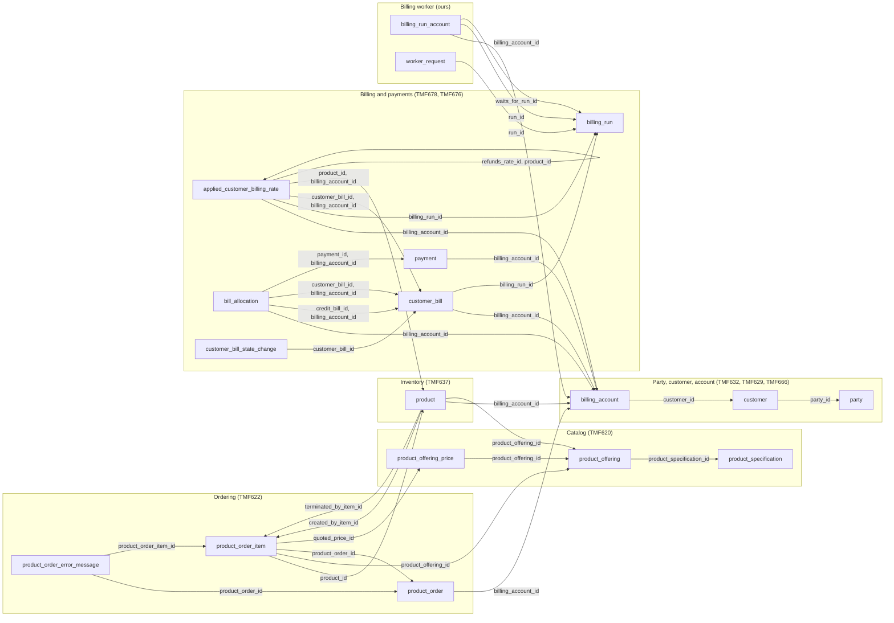
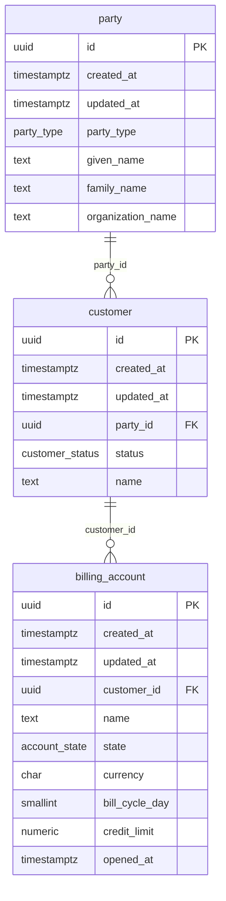
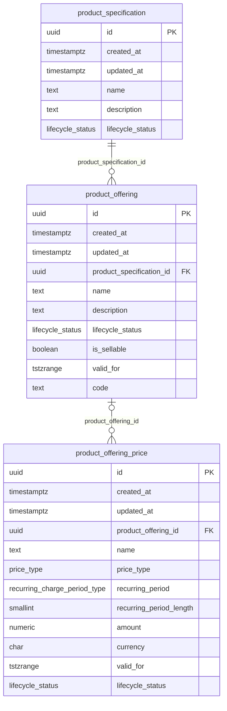
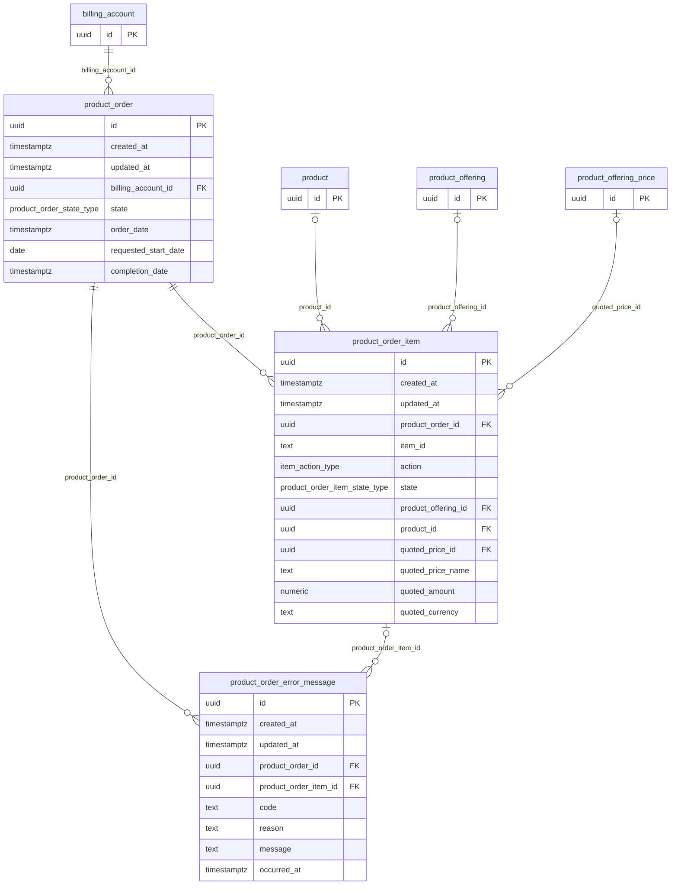
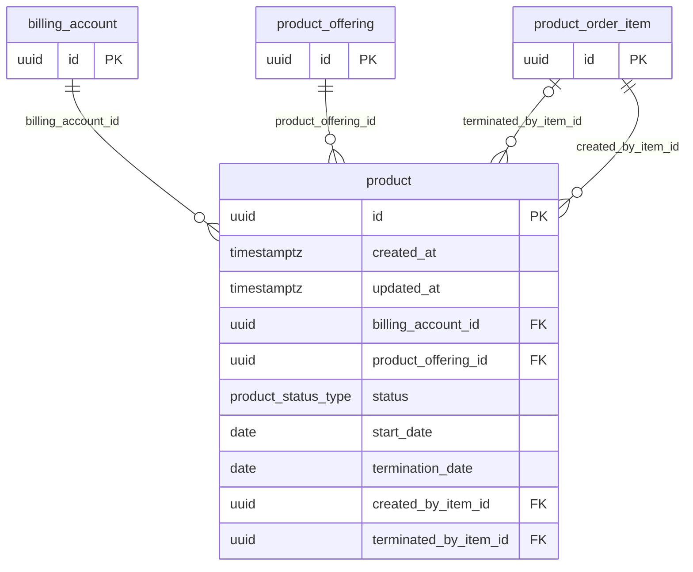
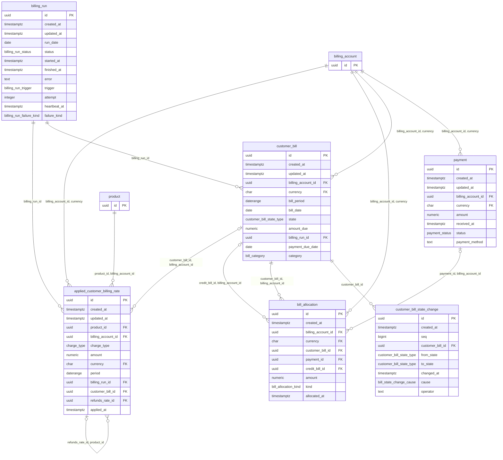
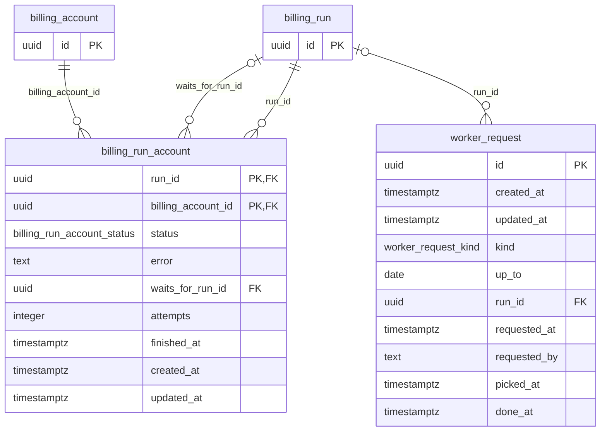

<!-- Generated by `make docs` (scripts/docs/generate.py) - do not edit by hand. -->

# Database reference

PostgreSQL schema at Alembic head **0008**, read from `pg_catalog` of a throwaway database migrated to head (`tests/docs_collect.py`). Descriptions are the tables' and columns' `COMMENT`s (migration `alembic/versions/0005_schema_comments.py`). Migrations live in [`alembic/versions/`](../../alembic/versions/); the schema rules behind them are explained in [domain.md](../domain.md).

| Table | Area | Description |
|---|---|---|
| [`party`](party.md) | party | SID Party (TMF632 individual / organization): a person or an organization, told apart by party_type. |
| [`customer`](customer.md) | party | SID Customer (TMF629 customer): the role a party plays towards us. The party is fixed at creation. |
| [`billing_account`](billing_account.md) | party | SID BillingAccount (TMF666 billingAccount, served as the BssBillingAccount extension): one customer, one currency, one bill cycle day. The balance is not stored: payments (done) minus all ABRs. |
| [`product_specification`](product_specification.md) | catalog | SID ProductSpecification (TMF620 productSpecification): what a product is, independent of how it is sold. |
| [`product_offering`](product_offering.md) | catalog | SID ProductOffering (TMF620 productOffering): a sellable offer built on one specification. Lifecycle only moves forward: In Design -> Active -> Retired. |
| [`product_offering_price`](product_offering_price.md) | catalog | SID ProductOfferingPrice (TMF620 productOfferingPrice): a price created on its own and attached to at most one offering. Never re-priced, never starts in the past, never ended retroactively; prices of one offering, type and currency never overlap. |
| [`product_order`](product_order.md) | ordering | SID ProductOrder (TMF622 productOrder): the only way to create or terminate products. Processed synchronously; a rejected order is stored with its reasons. |
| [`product_order_item`](product_order_item.md) | ordering | SID ProductOrderItem (TMF622 productOrderItem): one add or delete of one product. At most one open delete item per product (partial unique index). |
| [`product_order_error_message`](product_order_error_message.md) | ordering | TMF622 productOrderErrorMessage: why an order was rejected - one row per reason, for the order as a whole or for one item. |
| [`product`](product.md) | inventory | SID Product (TMF637 product): an instance of an offering on a billing account. Written only by orders; billable on start_date <= d < termination_date. |
| [`billing_run`](billing_run.md) | billing | One daily billing run per date (ours, not TMF). Only a billing run writes ABRs and bills; the worker's bookkeeping lives here (trigger, attempt, failure_kind). |
| [`applied_customer_billing_rate`](applied_customer_billing_rate.md) | billing | SID AppliedCustomerBillingRate, ABR (TMF678 appliedCustomerBillingRate): a recurring charge for the billable days of one cycle period, or the one refund of such a charge. Written only by a billing run. |
| [`customer_bill`](customer_bill.md) | billing | SID CustomerBill (TMF678 customerBill): issued on a cycle day, collects every unbilled ABR of the account whose run date is <= the bill date. Bills of one account never overlap. |
| [`payment`](payment.md) | billing | SID Payment (TMF676 v4 payment): money received on a billing account. Never changed or deleted. |
| [`bill_allocation`](bill_allocation.md) | billing | An amount applied to a customer bill (ours; TMF678 appliedPayment, TMF676 paymentItem): from a payment or from the credit of a negative bill, automatic (oldest open bill first) or explicit. Append-only. Bounds: per paid bill <= its amount due, per payment <= its amount, per credit note <= minus its amount due (deferred constraint trigger). |
| [`customer_bill_state_change`](customer_bill_state_change.md) | billing | Every state change of a customer bill (ours), oldest first; the first row of a bill is its issue (from_state NULL). |
| [`billing_run_account`](billing_run_account.md) | worker | The outcome of one billing account in one billing run (ours): ok, failed (with the error) or blocked (waiting for an earlier failed run of that account). |
| [`worker_request`](worker_request.md) | worker | The admin UI's queue for the billing worker (ours): catch-up and retry requests. The API only inserts; the worker picks them up oldest first. |

## Overview

Tables grouped by area; an arrow is a foreign key (labelled with its column).

## Party, customer, account (TMF632, TMF629, TMF666)

## Catalog (TMF620)

## Ordering (TMF622)

Tables from other areas are shown with their key only: [`billing_account`](billing_account.md), [`product`](product.md), [`product_offering`](product_offering.md), [`product_offering_price`](product_offering_price.md).

## Inventory (TMF637)

Tables from other areas are shown with their key only: [`billing_account`](billing_account.md), [`product_order_item`](product_order_item.md), [`product_offering`](product_offering.md).

## Billing and payments (TMF678, TMF676)

Tables from other areas are shown with their key only: [`billing_account`](billing_account.md), [`product`](product.md).

## Billing worker (ours)

Tables from other areas are shown with their key only: [`billing_account`](billing_account.md), [`billing_run`](billing_run.md).

## Enums

TMF-derived enums are verbatim from `spec/` (camelCase included) and locked by `tests/test_enum_lock.py`; the others are ours (migration comments say which).

| Enum | Values | Used by |
|---|---|---|
| `account_state` | `Active`, `Suspended`, `Closed` | [`billing_account.state`](billing_account.md) |
| `bill_allocation_kind` | `automatic`, `explicit` | [`bill_allocation.kind`](bill_allocation.md) |
| `bill_category` | `normal`, `creditNote` | [`customer_bill.category`](customer_bill.md) |
| `bill_state_change_cause` | `run`, `payment`, `operator` | [`customer_bill_state_change.cause`](customer_bill_state_change.md) |
| `billing_run_account_status` | `ok`, `failed`, `blocked` | [`billing_run_account.status`](billing_run_account.md) |
| `billing_run_failure_kind` | `accounts`, `run` | [`billing_run.failure_kind`](billing_run.md) |
| `billing_run_status` | `running`, `completed`, `failed` | [`billing_run.status`](billing_run.md) |
| `billing_run_trigger` | `scheduled`, `catchUp`, `retry` | [`billing_run.trigger`](billing_run.md) |
| `charge_type` | `recurring`, `refund` | [`applied_customer_billing_rate.charge_type`](applied_customer_billing_rate.md) |
| `customer_bill_state_type` | `new`, `onHold`, `validated`, `sent`, `settled`, `partiallyPaid` | [`customer_bill.state`](customer_bill.md), [`customer_bill_state_change.from_state`](customer_bill_state_change.md), [`customer_bill_state_change.to_state`](customer_bill_state_change.md) |
| `customer_status` | `Created`, `Active`, `Inactive` | [`customer.status`](customer.md) |
| `item_action_type` | `add`, `modify`, `delete`, `noChange` | [`product_order_item.action`](product_order_item.md) |
| `lifecycle_status` | `In Design`, `Active`, `Retired` | [`product_offering.lifecycle_status`](product_offering.md), [`product_offering_price.lifecycle_status`](product_offering_price.md), [`product_specification.lifecycle_status`](product_specification.md) |
| `party_type` | `Individual`, `Organization` | [`party.party_type`](party.md) |
| `payment_status` | `done` | [`payment.status`](payment.md) |
| `price_type` | `recurring`, `oneTime` | [`product_offering_price.price_type`](product_offering_price.md) |
| `product_order_item_state_type` | `acknowledged`, `rejected`, `pending`, `held`, `inProgress`, `cancelled`, `completed`, `failed`, `partial`, `assessingCancellation`, `pendingCancellation` | [`product_order_item.state`](product_order_item.md) |
| `product_order_state_type` | `acknowledged`, `rejected`, `pending`, `held`, `inProgress`, `cancelled`, `completed`, `failed`, `partial`, `assessingCancellation`, `pendingCancellation`, `draft`, `inProgress.accepted` | [`product_order.state`](product_order.md) |
| `product_status_type` | `created`, `pendingActive`, `cancelled`, `active`, `pendingTerminate`, `terminated`, `suspended`, `aborted` | [`product.status`](product.md) |
| `recurring_charge_period_type` | `monthly` | [`product_offering_price.recurring_period`](product_offering_price.md) |
| `worker_request_kind` | `catchUp`, `retry` | [`worker_request.kind`](worker_request.md) |

Every table except `billing_run_account` has the audit columns `id` (uuid, `gen_random_uuid()`), `created_at` and `updated_at` (database `now()`; a `BEFORE UPDATE` trigger calling `set_updated_at()` maintains `updated_at`). The extension `btree_gist` backs the exclusion constraints.
