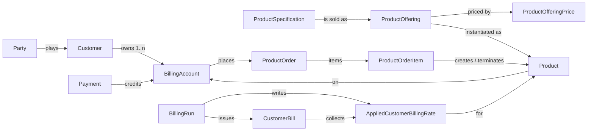

# Domain model and rules

The TM Forum SID entities as bss implements them, their lifecycles, and every business
rule with the code that enforces it and the test that proves it. Table-level detail
(columns, constraints, indexes) is in [db/](db/README.md); per-operation API detail in
[api/](api/README.md).

Citations: a file path is where the rule lives; `test_file.py::test_name` is a test that
fails if the rule is broken (CLAUDE.md records that every money rule was broken once on
purpose to see its test fail).

## Entities

| SID entity | Table | TMF API | Notes |
|---|---|---|---|
| Party (Individual, Organization) | `party` | TMF632 | one table, `party_type` decides the resource |
| Customer | `customer` | TMF629 | the role a party plays; party fixed at creation |
| BillingAccount | `billing_account` | TMF666 (`BssBillingAccount`) | one customer, **one currency**, one bill cycle day |
| ProductSpecification | `product_specification` | TMF620 | |
| ProductOffering | `product_offering` | TMF620 | optional unique offering code |
| ProductOfferingPrice | `product_offering_price` | TMF620 | monthly recurring (billed) or oneTime (stored only) |
| ProductOrder, ProductOrderItem | `product_order`, `product_order_item`, `product_order_error_message` | TMF622 | the only way to create or end products |
| Product | `product` | TMF637 (read-only) | |
| AppliedCustomerBillingRate (ABR) | `applied_customer_billing_rate` | TMF678 (read-only) | a charge or a refund |
| CustomerBill | `customer_bill` | TMF678 (read-only) | |
| Payment | `payment` | TMF676 v4 | |
| - (ours) | `billing_run`, `billing_run_account`, `worker_request` | internal API | the billing worker's bookkeeping |

A **subscriber** in the admin UI is a billing account (a customer with two accounts is
two rows; [decisions/frontend.md](decisions/frontend.md), "Frontend (stage 5) decisions").

## Lifecycles

| Entity | States | Transitions (who) | Code | Proven by |
|---|---|---|---|---|
| ProductOffering | `In Design`, `Active`, `Retired` | forward only: In Design -> Active -> Retired; Retired is final (PATCH, 409 otherwise) | `app/api/catalog.py` (`LIFECYCLE_STEPS`) | `tests/test_api_catalog_lifecycle.py::test_every_transition` |
| ProductSpecification, ProductOfferingPrice | same values | the offering's rule: forward only, Retired final (PATCH, 409 otherwise) | `app/api/catalog.py` (`_check_lifecycle`) | `tests/test_api_catalog_lifecycle.py::test_every_transition` |
| Customer | `Created`, `Active`, `Inactive` (ours: TMF629's `status` is a free string) | any of these (PATCH); any other value is a 422 | `app/api/customer.py` | `tests/test_api_parties.py::test_customer_round_trip`, `::test_customer_status_outside_the_enum_is_refused_on_patch` |
| BillingAccount | `Active`, `Suspended`, `Closed` (ours) | any (PATCH); ordering requires `Active`; billing ignores it | `app/api/account.py`, `app/ordering/process.py` | `tests/test_api_ordering.py::test_account_must_be_active_and_start_not_in_the_past` |
| ProductOrder | `acknowledged` -> `inProgress` -> `completed`, or `acknowledged` -> `rejected` | synchronous, in one transaction | `app/ordering/states.py` | `tests/test_order_states.py::test_the_allowed_transitions_are_exactly_these` |
| ProductOrderItem | as the order, plus `acknowledged` -> `cancelled` | the fine items of a rejected order are `cancelled` | `app/ordering/states.py` | `tests/test_order_states.py` |
| Product | `created`, `active`, `pendingTerminate`, `terminated`, `cancelled` (set by code); `pendingActive`, `suspended`, `aborted` exist in the enum only | add: `active` (starts today) or `created`; delete: `terminated` (today), `pendingTerminate` (future), `cancelled` (not started); worker: `created`/`pendingActive` -> `active`, `pendingTerminate` -> `terminated` on the date | `app/ordering/process.py` (`_execute`), `app/repository/products.py` (`flip_statuses`) | `tests/test_api_ordering.py::test_add_creates_an_active_product`, `::test_delete_with_a_future_date_is_pending_until_then`, `::test_delete_of_a_future_product_cancels_it_with_zero_billable_days`, `tests/test_worker_flips.py::test_flips_follow_the_dates` |
| CustomerBill | written `new`; never changes | billing run | `app/repository/billing.py` (`insert_bill`) | - |
| Payment | always `done` | POST | `app/api/payment.py` | `tests/test_api_payment.py::test_payment_is_recorded_as_done` |
| BillingRun | `running`, `completed`, `failed` (`failure_kind` accounts / run) | the worker | `app/worker/runs.py`, `app/worker/process.py` | [billing-worker.md](billing-worker.md) |

**Product status is cosmetic for money**: billing is driven by dates alone - billable on
`start_date <= d < termination_date`, excluding only `cancelled` and `aborted`
(`app/billing/core.py`, `billable_range`; `tests/test_billing_core.py::test_other_statuses_are_billed_by_dates`,
`::test_cancelled_or_aborted_status_is_never_billable`).

TMF-derived enums are copied verbatim from `spec/` (camelCase included) and locked by
`tests/test_enum_lock.py`; values are compared after `strip()`, because upstream
`ProductStatusType` spells `'aborted '` with a trailing space (stored as `aborted`).

## Shared rules

### Money

- `numeric(12,2)` in the database, `Decimal` in Python, a JSON **number** token on the
  wire - never a float anywhere (`app/api/tmfjson.py`;
  `tests/test_api_conventions.py::test_incoming_amount_never_passes_through_float`,
  `::test_the_encoder_refuses_floats`, `tests/test_billing_core.py::test_prorate_refuses_float`).
  FastAPI's own body parsing goes through float, so handlers parse the raw body
  themselves (`tests/test_api_conventions.py::test_fastapi_own_body_parsing_goes_through_float`).
- An amount with more than 2 decimals is a 422, never rounded
  (`tests/test_api_conventions.py::test_more_than_two_decimals_is_rejected_not_rounded`).
- **One currency per billing account**, enforced by composite foreign keys
  `(billing_account_id, currency) -> billing_account (id, currency)` on bills, ABRs and
  payments (`alembic/versions/0001_initial_schema.py`;
  `tests/test_constraints.py::test_currency_must_match_billing_account`). Taxes are out
  of scope.
- **No balance column.** Balance = payments (`done`) - sum of all ABRs; refunds are
  negative ABRs, so they count as credits. Positive = the customer is in credit
  (`app/repository/billing.py`, `account_balance`;
  `tests/test_api_parties.py::test_balance_is_payments_minus_charges_positive_means_credit`).
- **Credit limit** is informational only: shown and warned about, never refuses anything
  (`tests/test_api_credit_limit_and_code.py::test_the_credit_limit_never_blocks_an_order`).

### Half-open ranges

Every range is `[start, end)`: `valid_for` is a `tstzrange` (NULL upper = open-ended,
CHECKs forbid any other bound shape: `tests/test_constraints.py::test_closed_upper_bound_is_rejected`),
billing periods and bill periods are `daterange`, and `product.termination_date` is
exclusive - the first day not billed. **The activation day is billed, the termination day
is not**; a product activated and terminated on the same day is charged 0 days
(`tests/test_billing_core.py::test_5_same_day_start_and_termination_is_never_charged`).

### Clock injection and BILLING_TZ

- **Nothing in `app/` reads the wall clock except `app/clock.py`** - a test greps for
  `datetime.now()`, `date.today()`, `datetime.utcnow()` and `time.time()`
  (`tests/test_clock.py::test_only_clock_module_reads_the_wall_clock`). The API gets a
  `Clock` through the `get_clock` dependency (`app/api/deps.py`), the worker through
  `app/worker/runtime.py`; tests pin it with `FixedClock`.
- **"Today" is the calendar date in `BILLING_TZ`** (default `Europe/Moscow`;
  `tests/test_clock.py::test_today_is_the_date_in_billing_timezone`). Incoming date-times
  for date fields become the date in BILLING_TZ (`2026-10-01T23:30:00Z` is `2026-10-02`
  in Moscow), outgoing dates are midnight BILLING_TZ (`app/api/common.py`).
- Rows' `created_at`/`updated_at` are the database's `now()`, outside the injected clock,
  and are **never used for billing**, nor shown by the API. Where a business instant is
  needed it is stored from the clock: `billing_account.opened_at`,
  `product_order.order_date` / `completion_date` (also a product's `creationDate`),
  `payment.received_at`, `applied_customer_billing_rate.applied_at` (an ABR's `date`).

## Catalog invariants

| Invariant | Code | Proven by |
|---|---|---|
| Offering, specification and price lifecycles only move forward (above) | `app/api/catalog.py` (`_check_lifecycle`) | `tests/test_api_catalog_lifecycle.py` |
| An offering's `validFor` is never rewritten in the past: PATCH may not move the start, or set or move the end, to before now (409); repeating the current value is fine. Billing never reads it, so ending an offering leaves its live products priced (the price rules below keep that) | `_check_offering_period` | `tests/test_api_offering_validity.py` |
| Prices of one offering, type and currency never overlap (exclusion constraint) | `product_offering_price_no_overlap` | `tests/test_constraints.py::test_overlapping_price_is_rejected_adjacent_is_accepted`, `tests/test_api_catalog.py::test_overlapping_prices_cannot_be_attached_to_one_offering` |
| A price is attached to at most one offering and never detached | `app/api/catalog.py` (`_attach_prices`, `patch_offering`) | `tests/test_api_catalog.py::test_a_price_belongs_to_at_most_one_offering`, `::test_a_price_is_never_detached` |
| A price is never re-priced (amount, type, period read-only; start cannot move) | `PRICE_IMMUTABLE`, `patch_price` | `::test_changing_a_price_means_ending_it_and_attaching_a_new_one` |
| **A price never starts in the past** (created or attached with a start < now: 409) - catch-up billing charges past days at the price valid then, so a past-starting price would back-charge them | `create_price`, `_not_in_the_past` | `::test_a_price_cannot_start_in_the_past` |
| A price is never ended retroactively (end only set/moved to >= now, only while not yet ended) | `patch_price` | `::test_a_price_cannot_be_ended_retroactively` |
| **No price gaps (D-W18):** ending a recurring price is refused unless a successor starts exactly at the end, or every live product of the offering in that currency is terminated by the first uncovered business date | `_no_gap` | `tests/test_api_price_gap.py` |
| **Ordering keeps the other side closed (D-W20):** an add item is rejected `priceEnds` unless the offering's recurring prices, from the start date on, form a gapless chain ending open-ended | `app/ordering/process.py` (`_price_gap`) | `tests/test_order_price_chain.py` |
| Together: **a live product has a price for every future day** | both above | both above |
| **Atomic price change (D-W21):** `POST /internal/v1/productOffering/{id}/priceChange` ends the open price at midnight of `validFrom` (>= tomorrow) and attaches the successor from that instant in one transaction; TMF620 cannot do it while a product is live (attaching first overlaps, ending first leaves a gap) | `app/internal/catalog.py` | `tests/test_internal_price_change.py::test_tmf620_cannot_change_a_live_price_in_either_order`, `::test_a_live_price_changes_in_one_step`, `::test_a_failure_half_way_changes_nothing` |

A new price can only price products starting **tomorrow** at the earliest: its start
must be >= now, and orders look the price up at midnight of the product's start date.
Existing products pick up a changed price from their first billing period starting on or
after `validFrom` (the core prices each period at its first billable day;
`tests/test_billing_core.py::test_9_price_change_applies_from_the_next_period`).
Retiring an offering does not end its prices; its products keep billing.

## Ordering (TMF622)

Synchronous, in the request's transaction (`app/ordering/process.py`, `place_order`):

1. **Refused (4xx, nothing stored)** when the order cannot even be stored: malformed or
   unknown attributes (400), missing mandatory fields, references to things that do not
   exist, duplicate item ids, a product in two delete items, add/delete items missing
   their offering/product (422) - `tests/test_api_ordering.py::test_malformed_orders_are_4xx_and_not_stored`.
2. The products of delete items are **locked `FOR UPDATE` in id order** before anything
   about them is read, so a concurrent second delete waits and is then rejected
   `productAlreadyEnded` (`tests/test_order_concurrency.py::test_a_concurrent_second_delete_waits_and_is_rejected`).
3. **Validated before any row is inserted.** Any business problem rejects the **whole**
   order: it is stored `rejected` with one `productOrderErrorMessage` per reason, failing
   items `rejected`, the others `cancelled`, nothing executed - and the answer is
   **201**, not a 4xx (`tests/test_api_ordering.py::test_one_bad_item_rejects_the_whole_order`,
   `::test_a_rejected_order_is_stored_with_its_reason`). Rejection codes:
   `accountNotActive`, `requestedStartDateInPast` (order level);
   `billingAccountMismatch`, `offeringNotSellable`, `offeringNotValid`,
   `noRecurringPrice`, `priceEnds`, `productOfOtherAccount`, `productAlreadyEnded`,
   `openDeleteItem`, `productNotStarted`, `openModifyItem`, `offeringUnchanged`,
   `terminationInPeriod` (item level) - see
   [api/tmf622-product-ordering.md](api/tmf622-product-ordering.md).
4. Otherwise executed: `add` creates a product starting on the requested date (today
   when omitted; never in the past), `delete` sets its exclusive termination date (or
   cancels a product that has not started), `modify` changes the product's offering from
   the requested date on (billed prorated: the old offering until the day before), and
   `noChange` changes nothing. The order is `completed` with a `completion_date` from
   the clock.

The requested date is our interpretation: TMF has no per-item date, so
`requestedStartDate` is the start date of add items, the termination date of delete
items and the change day of modify items. Orders are never changed afterwards (no PATCH, DELETE or cancel).

## Billing

The billing core (`app/billing/core.py`) is **pure**: no database, clock or I/O.
`compute(state, as_of, tz)` takes one account's frozen `BillingState` and returns the
ABRs and bills to write; `app/billing/adapter.py` (`bill_account`) loads the state,
computes and writes it in one transaction (a savepoint inside the caller's). Only a
billing run writes ABRs and bills (`billing_run_id` is NOT NULL on both).

### Periods

Calendar-aligned to the account's `bill_cycle_day` D (1..28, so it exists in every
month): `[D of month M, D of month M+1)`, 28-31 days (`cycle_period`). The cycle day is
fixed after creation (PATCH is a 409; changing it is issue #68).

### When a period is charged

**In advance, once its first billable day is <= as_of.** The first billable day is
`max(period start, product start_date)`. Charging waits for the product's start, not
just the period's, because the price is looked up at that day's midnight, which must be
in the past when the charge is written. Consequence: **a product cancelled before its
start is never charged** (`tests/test_billing_core.py::test_1_full_period_charged_in_advance`,
`::test_future_start_is_not_charged_before_its_first_billable_day`,
`::test_product_cancelled_before_its_start_is_never_charged`).

### Price and amount

- The offering's monthly recurring price in the account's currency, valid at **midnight
  (BILLING_TZ) of the period's first billable day** (`price_at`). A price change
  mid-period applies from the next period. None found raises `MissingPrice` naming
  product, day and currency (never skipped); more than one raises `InconsistentState`
  (`::test_missing_price_names_product_and_date`, `::test_9_price_boundary_is_midnight_in_billing_tz`).
- `amount = round_half_even(price x billable_days / period_days, 0.01)` - **banker's
  rounding, applied once per ABR, never on intermediate values**; the period's own length
  is the denominator (`prorate`; `::test_3_half_even_rounding`,
  `::test_10_period_length_is_the_denominator`). A charge that rounds to 0.00 is still
  written (`::test_charge_that_rounds_to_zero_is_still_written`).

### Expected-vs-actual diff and refunds

Per product and period the core compares what *should* be charged with what is stored
(`_period_diff`):

- nothing stored -> a `recurring` charge for the billable range;
- a charge stored -> it is re-checked against its price (else `InconsistentState`), then
  `diff = expected - (charge + refunds)`: 0 -> nothing; negative -> **a refund of `diff`**
  for the unbilled tail `[termination_date, charge end)` (or the whole charge when nothing
  is billable any more), pointing at the charge; positive -> `InconsistentState`
  (impossible by the rules).
- The refund is **never priced on its own days**: charge + refund must equal one correct
  rounding of the used days, or cent drift would accumulate
  (`tests/test_billing_properties.py::test_refund_keeps_the_period_net_exact`).
- **One refund per charge** (`refunds_rate_id UNIQUE`; `tests/test_constraints.py::test_second_refund_of_the_same_charge_is_rejected`).
  Enough because termination dates are immutable: a product is deleted once.
- If the termination is already known when the period is charged there is one reduced
  charge and no refund (`tests/test_billing_core.py::test_7_termination_known_before_charging_gives_one_reduced_charge`);
  daily runs and one catch-up run can therefore store different rows with the same net
  per period (`tests/test_billing_properties.py::test_daily_runs_and_one_catch_up_run_give_the_same_net_per_period`).
- ABRs of one product and type never overlap (`abr_no_overlap` exclusion constraint;
  `tests/test_constraints.py::test_overlapping_abr_is_rejected_adjacent_is_accepted`).

### Bills

A bill on cycle day D covers `[D, next D)` and collects every unbilled ABR of the account
whose **run date** (the `run_date` of the run that wrote it) is <= D (`_bills`). A run
issues the bills for every cycle day after the account's last bill up to as_of; one that
would collect nothing is skipped, but a 0.00 bill of 0.00 charges is issued; `amount_due`
may be negative (`tests/test_billing_core.py::test_bill_on_the_cycle_day_collects_the_charge_of_that_run`,
`::test_mid_cycle_start_goes_onto_the_next_bill`, `::test_empty_bills_are_skipped_and_zero_bills_are_not`,
`::test_bill_may_be_negative`). Run date, not `created_at`, because `created_at` is the
database's clock: a run for D that crosses midnight would otherwise date its ABRs D+1.
Every ABR lands on exactly one bill (`tests/test_billing_properties.py::test_bills_collect_every_abr_exactly_once`).

### End-of-day visibility

**The run for D sees order-driven facts completed before 00:00 of D in BILLING_TZ**
(end-of-day processing of D-1): products by the `completion_date` of the order that
created them, terminations and cancellations by the order that set them; an invisible
termination is passed with the status the product had before it
(`app/billing/adapter.py`, `visible_before`; `app/repository/billing.py`, `load_products`).
An order placed on D is first seen by the run of D+1, whatever time the run of D
executes - so **a replayed date sees exactly what the daily run saw**
(`tests/test_billing_db.py::test_an_order_placed_on_d_is_invisible_to_run_d_and_visible_to_run_d_plus_1`,
`::test_replay_after_an_outage_gives_the_same_rows_and_bills_as_daily_runs`).

Prices need no such filter: a price change only takes effect at or after the moment it
was made, and the core only looks prices up at midnights <= as_of.

### Catch-up order and idempotence

- Running the same date again writes nothing (`tests/test_billing_core.py::test_11_running_twice_emits_nothing`,
  `tests/test_billing_properties.py::test_a_second_run_at_the_same_date_emits_nothing`).
- After an outage every missed date is replayed **in order, each with its own run**, so
  run dates and bills match daily runs; a single multi-month `as_of` call is for tests
  only - it would put every catch-up ABR on the bill after as_of
  (`tests/test_billing_core.py::test_8_catch_up_charges_every_missed_period`,
  `tests/test_billing_properties.py::test_replay_of_the_same_dates_is_identical`). The
  worker enforces the order ([billing-worker.md](billing-worker.md)).

### Concurrency and guards

`bill_account` locks the billing account row (`FOR UPDATE`) before reading, so a
concurrent second call waits and then writes nothing
(`tests/test_billing_db.py::test_two_concurrent_bill_account_calls_serialize_on_the_account`),
and only writes into a run that is still `running`, re-read `FOR SHARE`
(`::test_a_run_that_is_not_running_writes_nothing`). Any `BillingError`
(`MissingPrice`, `InconsistentState`) rolls the whole account back.

### Property tests

`tests/test_billing_properties.py` (hypothesis; 50 examples per property in `make test`,
200 in `make verify`) checks against an independent oracle that counts billable days one
by one (`tests/billing_sim.py`): idempotence, net per period = one rounding, lifetime
without drift, refund shape, no overlap, precision and currency, every ABR on exactly
one bill, replay identical, daily vs catch-up equal net per period.

## Open questions

Changing `billCycleDay` is issue #68; suspension semantics are decided
([billing-core.md](decisions/billing-core.md#open-questions)): a `Suspended`/`Closed` account
and a `suspended` product are billed like any other.
