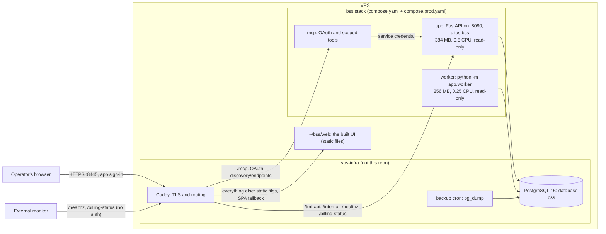

# bss - overview

bss is a small **billing and subscriber management system (BSS)** for a telecom-style
subscription business: a product catalog with daily, weekly, monthly and yearly recurring prices, customers and
billing accounts, orders that add and end products, a daily billing run that charges and
refunds pro rata and issues bills, payments, and a browser admin console for operators.
It is a demo-sized but rule-complete system: every money rule is enforced in code and
proven by tests.

The data model is the **TM Forum SID** (Shared Information/Data model) and the external
surface is the **TM Forum Open APIs** (TMF6xx) - see [domain.md](domain.md).

## What exists, by stage

The project was built in stages ([decisions/data-model.md](decisions/data-model.md), "Stage order"); progress is tracked from the
code by `make progress` into [PROGRESS.md](PROGRESS.md) against
[progress/scope.yaml](progress/scope.yaml).

| Stage | What | Status |
|---|---|---|
| 1 | Database schema and repository functions | built: 41 scoped database items, migrations through `0030` ([db/](db/README.md)) |
| 2 | TMF Open API backend (8 APIs) | built: 152 scoped API items, including internal/service routes, in PROGRESS.md |
| 3 | Billing core (pure) and its database adapter | built ([domain.md](domain.md#billing)) |
| 4 | Billing worker: daily runs, catch-up/retry, on-demand bills and documents | built: worker 15/15 proven ([billing-worker.md](billing-worker.md)); Billing runs UI built |
| 5 | Admin UI (React) and its internal API | built: 27/27 UI items, including Billing runs and bill settlement ([ui.md](ui.md)) |

Implementation and test coverage are measured for all four areas in PROGRESS.md.

The input/read-completeness slice adds strict TMF write queries and type checks,
historical order price quotes, product prices/navigation, and daily bill-cycle reads
with bill links and next bill dates ([decisions/tmf-api.md](decisions/tmf-api.md)).

TMF620 includes product catalogs, root categories, subcategories and offering
membership ([decisions/catalog.md](decisions/catalog.md#categories-and-product-catalogs-2026-10-16)).
Refunds, on-demand bills and presentation configuration extend the billing lifecycle
([decision](decisions/billing-completion.md)). Formats render detailed/summary JSON;
external delivery and payment processing remain out of scope.
Non-listener operation coverage across the eight vendored TMF APIs is 129/129 (100%);
this counts operations, not complete conformance of every attribute or behavior.

## Scope

In scope: one currency per billing account; recurring product charges with intervals
described in [charge-periods.md](decisions/charge-periods.md); monthly invoices;
taxes, offering changes, order cancellation, product suspension/resumption, event
notifications, refunds, payments, balance, and a daily worker with catch-up/retry.

Prepaid MVNO on a direct T-Mobile connection (epic #182,
[decision](decisions/prepaid.md#prepaid-mvno-on-t-mobile-scope-and-integration-pattern-2026-11-05-epic-182)):
plan-based prepaid with renewal from the balance or a saved card, add-ons and one-time
fees; pay-as-you-go rating; the line lifecycle (grace, suspension, deactivation, number
aging); SIM and eSIM inventory and swap; number pools, port-in and port-out; usage records
and allowances; customer notifications; account PIN, verification and line locks; device
IMEI checks. Network provisioning, taxes, card payments and SMS/email go through
placeholder adapters (`app/integrations/`). Caps and throttling are enforced by the network.

Out of scope: real T-Mobile, tax engine, payment gateway and SMS/email connections;
vouchers and PIN cards; self-care; real-time online charging; extending postpaid (dunning,
external bill delivery); changing an account's bill cycle day. On postpaid, one-time and
alteration prices can be recorded but do not produce standalone billing charges.
Suspension does not change postpaid date-based billing.

## Implemented APIs

| API | Version | Base path | Spec file |
|---|---|---|---|
| TMF620 Product Catalog | 5.0.0 | `/tmf-api/productCatalogManagement/v5` | `spec/TMF620-Product_Catalog_Management-v5.0.0.oas.yaml` |
| TMF622 Product Ordering | 5.0.0 | `/tmf-api/productOrderingManagement/v5` | `spec/TMF622-ProductOrdering-v5.0.0.oas.yaml` |
| TMF629 Customer | 5.0.1 | `/tmf-api/customer/v5` | `spec/TMF629-Customer_Management-v5.0.1.oas.yaml` |
| TMF632 Party | 5.0.0 | `/tmf-api/partyManagement/v5` | `spec/TMF632-Party_Management-v5.0.0.oas.yaml` |
| TMF637 Product Inventory | 5.0.0 | `/tmf-api/productInventory/v5` | `spec/TMF637-ProductInventory-v5.0.0.oas.yaml` |
| TMF666 Account | 5.0.0 | `/tmf-api/accountManagement/v5` | `spec/TMF666-Account_Management-v5.0.0.oas.yaml` |
| TMF676 Payment | **4.0.0** (no v5 exists) | `/tmf-api/payment/v4` | `spec/TMF676-Payment-v4.0.0.swagger.json` |
| TMF678 Customer Bill | 5.0.0 | `/tmf-api/customerBillManagement/v5` | `spec/TMF678-CustomerBill-v5.0.0.oas.yaml` |
| TMF635 Product Usage | 5.0.0 | `/tmf-api/productUsageManagement/v5` | `spec/TMF635-Product_Usage_Management-v5.0.0.oas.yaml` |
| TMF639 Resource Inventory | 5.0.0 | `/tmf-api/resourceInventory/v5` | `spec/TMF639-Resource_Inventory_Management-v5.0.0.oas.yaml` |
| TMF654 Prepay Balance | 4.0.0 | `/tmf-api/prepayBalanceManagement/v4` | `spec/TMF654-PrepayBalance-v4.0.0.swagger.json` |
| TMF670 Payment Method | 4.0.0 | `/tmf-api/paymentMethod/v4` | `spec/TMF670-PaymentMethod-v4.0.0.swagger.json` |
| TMF681 Communication | 4.0.0 | `/tmf-api/communicationManagement/v4` | `spec/TMF681-Communication-v4.0.0.swagger.json` |
| Internal (ours, for the UI) | v1 | `/internal/v1` | `spec/internal/bss-internal.oas.yaml` |

The specs are vendored unmodified, pinned by upstream commit and blob SHA
(`spec/README.md`, `tests/test_spec_provenance.py`). Every response in the test suite is
validated against them (`tests/apiclient.py`). Per-operation reference, extensions
(`BssBillingAccount`) and deviations: [api/](api/README.md).

## Code map

| Path | What |
|---|---|
| `app/main.py` | FastAPI app: mounts the TMF routers, the internal API, `/healthz`, `/billing-status` |
| `app/api/` | TMF Open API surface: one module per API plus shared conventions (`errors`, `tmfjson`, `common`, `listing`, `deps`) |
| `app/internal/` | internal API for the admin UI |
| `app/ordering/` | order processing (`process.py`) and the order/item state machine (`states.py`) |
| `app/billing/` | billing core (`core.py`, pure; `model.py`, dataclasses) and `adapter.py` (load -> compute -> write) |
| `app/worker/` | the billing worker process (`python -m app.worker`) |
| `app/repository/` | data access: plain functions on a psycopg connection, never commit |
| `app/clock.py` | the only wall-clock reader (`SystemClock`, `FixedClock`) |
| `app/config.py` | settings from environment variables only |
| `alembic/versions/` | hand-written migrations |
| `frontend/` | admin UI: Vite + React + TypeScript |
| `tests/` | pytest suite, contract validation, seed data, doc and progress collectors |

## Runtime architecture

Production is one VPS (`vps-test`: Debian 12, 1 vCPU, ~2 GB RAM) whose primary purpose
is a VPN server; bss runs next to it under strict limits. PostgreSQL and Caddy are **not
part of this repository**: the separate **vps-infra** project runs one of each for every
app on the host, plus the database backups ([decisions/infra.md](decisions/infra.md#shared-infrastructure-vps-infra)).

- **app** and **worker** are the same image (built locally, shipped with `docker save |
  ssh docker load`; never built on the VPS) - `compose.prod.yaml`. The app binds
  `127.0.0.1:18081` on the host (for an SSH tunnel) and joins vps-infra's `shared` network
  as `bss`, where Caddy reaches it. The worker serves no HTTP.
- **The UI** is static files built locally and rsynced into `~/bss/web`, which Caddy
  serves read-only on the same origin as the API - no CORS ([decisions/infra.md](decisions/infra.md#deploying-the-ui-stage-5-checkpoint-7),
  "Deploying the UI").
- **Database**: database and role `bss` on vps-infra's PostgreSQL (`postgres:5432` on
  the `shared` network). Migrations run from this repository during the deploy, before
  the app starts (`scripts/deploy.sh`).
- The VPS reboots nightly at 03:00; all services have `restart: unless-stopped`, and a
  billing run interrupted by the reboot is taken over by the next worker
  ([billing-worker.md](billing-worker.md#ownership-and-takeover)).

Locally (WSL2) `docker compose` adds `compose.override.yaml`: a local PostgreSQL (`db`),
the app with hot reload on `127.0.0.1:8081` (`APP_PORT`), and Node-only-in-containers services for the
UI. There is no long-running local worker (`make worker-once`). See
[operations.md](operations.md).

## Authentication and operator identity

The app authenticates operators with sessions and roles (`admin` and `user`).
Caddy serves the UI without basic auth following U11; business API routes require
a session or a service credential even when reached directly on the shared network.

- The operator comes from the session. Admins manage users; both roles perform
  business operations and change their own passwords.
- MCP authenticates with `BSS_SERVICE_SECRET` and a validated `mcp:<name>` principal.
  A separate `BSS_SMOKE_SECRET` grants read-only smoke access. Credentials are never
  printed and cannot access user-management or session endpoints.
- Health/billing status and the service identity root remain public. Interactive
  `/docs`, `/redoc` and `/openapi.json` HTTP endpoints are disabled; tooling uses
  in-process OpenAPI.

See [user management](decisions/users.md) for the implemented security contract.

## Configuration

Environment variables only (`app/config.py`); no config files.

| Variable | Default | Meaning |
|---|---|---|
| `APP_ENV` | `prod` (unset means prod) | `dev` locally, `staging` on the VPS (compose); `test` enables `WORKER_FAKE_NOW` |
| `DATABASE_URL` | - | PostgreSQL URL |
| `LOG_LEVEL` | `info` | |
| `BILLING_TZ` | `Europe/Moscow` | the zone that defines "today" for billing |
| `BILLING_RUN_AT` | `00:30` | local time of the daily run; the worker refuses anything not strictly between 00:00 and 02:00 |
| `UI_CURRENCY` | `USD` | the one currency the admin UI works in |
| `WORKER_FAKE_NOW` | unset | tests only: pins the worker's clock; refused unless `APP_ENV=test` (`app/worker/runtime.py`) |
| `WORKER_LIVENESS_FILE` | `/tmp/worker-alive` | the worker's healthcheck file |

`BILLING_TZ` and `BILLING_RUN_AT` are passed to neither container in production, so app
and worker always agree on the defaults (`compose.prod.yaml`).
