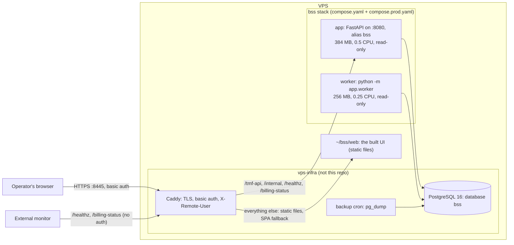

# bss - overview

bss is a small **billing and subscriber management system (BSS)** for a telecom-style
subscription business: a product catalog with monthly recurring prices, customers and
billing accounts, orders that add and end products, a daily billing run that charges and
refunds pro rata and issues bills, payments, and a browser admin console for operators.
It is a demo-sized but rule-complete system: every money rule is enforced in code and
proven by tests.

The data model is the **TM Forum SID** (Shared Information/Data model) and the external
surface is the **TM Forum Open APIs** (TMF6xx) - see [domain.md](domain.md).

## What exists, by stage

The project was built in stages (CLAUDE.md, "Stage order"); progress is tracked from the
code by `make progress` into [PROGRESS.md](PROGRESS.md) against
[progress/scope.yaml](progress/scope.yaml).

| Stage | What | Status |
|---|---|---|
| 1 | Database schema and repository functions | built: 16 tables, migrations `0001`-`0005` ([db/](db/README.md)) |
| 2 | TMF Open API backend (8 APIs) | built: 54/54 API items in PROGRESS.md |
| 3 | Billing core (pure) and its database adapter | built ([domain.md](domain.md#billing)) |
| 4 | Billing worker: the daily run, failures, catch-up, retry | built and deployed: worker 10/10 proven ([billing-worker.md](billing-worker.md)); the **Billing runs UI screen is planned** (`ui.billingRuns.*` not implemented, 0/3) |
| 5 | Admin UI (React) and its internal API | built: 10/13 UI items - all but the Billing runs screen ([ui.md](ui.md)) |

"Tested" for db/api/ui and "deployed" for every area are not measured yet (PROGRESS.md
shows `n/a` / `unknown`): the tracker's steps 3-5 are **planned** (CLAUDE.md, "Next
session").

## Scope

In scope: one-currency-per-account monthly recurring charges with daily proration,
refunds when a termination becomes known after charging, bills on the account's cycle
day, payments, balance, a credit limit that only warns, the daily billing run with
failure isolation and operator catch-up/retry.

Out of scope (CLAUDE.md, "Domain model & decisions"): taxes, one-time charges in billing
(a `oneTime` price can be stored but is never billed), `modify` order items and
cancelProductOrder, changing an account's bill cycle day, suspension semantics (a
`Suspended` account is still billed by dates), event notifications (`/hub`, listeners),
payment processing (a payment is recorded as received).

## Implemented APIs

| API | Version | Base path | Spec file |
|---|---|---|---|
| TMF620 Product Catalog | 5.0.0 | `/tmf-api/productCatalogManagement/v5` | `spec/TMF620-Product_Catalog_Management-v5.0.0.oas.yaml` |
| TMF622 Product Ordering | 5.0.0 | `/tmf-api/productOrderingManagement/v5` | `spec/TMF622-ProductOrdering-v5.0.0.oas.yaml` |
| TMF629 Customer | 5.0.1 | `/tmf-api/customerManagement/v5` | `spec/TMF629-Customer_Management-v5.0.1.oas.yaml` |
| TMF632 Party | 5.0.0 | `/tmf-api/partyManagement/v5` | `spec/TMF632-Party_Management-v5.0.0.oas.yaml` |
| TMF637 Product Inventory | 5.0.0 | `/tmf-api/productInventory/v5` | `spec/TMF637-ProductInventory-v5.0.0.oas.yaml` |
| TMF666 Account | 5.0.0 | `/tmf-api/accountManagement/v5` | `spec/TMF666-Account_Management-v5.0.0.oas.yaml` |
| TMF676 Payment | **4.0.0** (no v5 exists) | `/tmf-api/paymentManagement/v4` | `spec/TMF676-Payment-v4.0.0.swagger.json` |
| TMF678 Customer Bill | 5.0.0 | `/tmf-api/customerBillManagement/v5` | `spec/TMF678-CustomerBill-v5.0.0.oas.yaml` |
| Internal (ours, for the UI) | v1 | `/internal/v1` | `spec/internal/bss-internal.oas.yaml` |

The specs are vendored unmodified, pinned by upstream commit and blob SHA
(`spec/README.md`, `tests/test_spec_provenance.py`). Every response in the test suite is
validated against them (`tests/apiclient.py`). Per-operation reference, extensions
(`BssBillingAccount`) and deviations: [api/](api/README.md).

## Code map

| Path | What |
|---|---|
| `app/main.py` | FastAPI app: mounts the TMF routers, the internal API, `/healthz`, `/billing-status` |
| `app/api/` | TMF Open API surface: one module per API plus shared conventions (`errors`, `tmfjson`, `common`, `listing`, `deps`) |
| `app/internal/` | internal API for the admin UI |
| `app/ordering/` | order processing (`process.py`) and the order/item state machine (`states.py`) |
| `app/billing/` | billing core (`core.py`, pure; `model.py`, dataclasses) and `adapter.py` (load -> compute -> write) |
| `app/worker/` | the billing worker process (`python -m app.worker`) |
| `app/repository/` | data access: plain functions on a psycopg connection, never commit |
| `app/clock.py` | the only wall-clock reader (`SystemClock`, `FixedClock`) |
| `app/config.py` | settings from environment variables only |
| `alembic/versions/` | hand-written migrations |
| `frontend/` | admin UI: Vite + React + TypeScript |
| `tests/` | pytest suite (586 tests), contract validation, seed data, doc and progress collectors |

## Runtime architecture

Production is one VPS (`vps-test`: Debian 12, 1 vCPU, ~2 GB RAM) whose primary purpose
is a VPN server; bss runs next to it under strict limits. PostgreSQL and Caddy are **not
part of this repository**: the separate **vps-infra** project runs one of each for every
app on the host, plus the database backups (CLAUDE.md, "Shared infrastructure").

- **app** and **worker** are the same image (built locally, shipped with `docker save |
  ssh docker load`; never built on the VPS) - `compose.prod.yaml`. The app binds
  `127.0.0.1:18081` on the host (for an SSH tunnel) and joins vps-infra's `shared` network
  as `bss`, where Caddy reaches it. The worker serves no HTTP.
- **The UI** is static files built locally and rsynced into `~/bss/web`, which Caddy
  serves read-only on the same origin as the API - no CORS (CLAUDE.md, "Deploying the
  UI").
- **Database**: database and role `bss` on vps-infra's PostgreSQL (`postgres:5432` on
  the `shared` network). Migrations run from this repository during the deploy, before
  the app starts (`scripts/deploy.sh`).
- The VPS reboots nightly at 03:00; both services have `restart: unless-stopped`, and a
  billing run interrupted by the reboot is taken over by the next worker
  ([billing-worker.md](billing-worker.md#ownership-and-takeover)).

Locally (WSL2) `docker compose` adds `compose.override.yaml`: a local PostgreSQL (`db`),
the app with hot reload on `127.0.0.1:8080`, and Node-only-in-containers services for the
UI. There is no long-running local worker (`make worker-once`). See
[operations.md](operations.md).

## Authentication and operator identity

All of it is configured in vps-infra's Caddy site block, requested in
[vps-infra-change-request.md](vps-infra-change-request.md); the app itself has **no
authentication**.

- **Basic auth** in Caddy protects everything on the public port except `/healthz` and
  `/billing-status`, which are carved out for the external monitor and expose nothing
  but a status (`app/main.py`, `app/status.py`).
- **`X-Remote-User`**: Caddy *sets* (overwrites) this header from the basic-auth user on
  the authenticated routes and removes it on the open ones. The app reads it in
  `GET /internal/v1/context` (`operator`) and stores it as `requested_by` on worker
  requests; anything not matching `^[A-Za-z0-9._@-]{1,64}$` is reported as no operator
  (`app/internal/context.py`; `tests/test_internal_api.py::test_context_operator_comes_from_the_proxy_header`).
  **It is display-only, not proof of identity**: any container on the `shared` network,
  or anyone with a shell or an SSH tunnel on the VPS, can reach the app directly and set
  it. Nothing is authorised by it.
- **The `smoke` user**: a second basic-auth user with its own password, **GET/HEAD
  only** - Caddy answers any other method with 403 before the app. `scripts/web-smoke.sh`
  uses it after every deploy; its plaintext lives only in the workstation's local
  `.env.smoke`, never shipped and never printed (`scripts/deploy.sh`).
- FastAPI's default `/docs`, `/redoc` and `/openapi.json` are served (behind basic auth
  in production); whether they should stay is an open decision (CLAUDE.md, "Next
  session").

## Configuration

Environment variables only (`app/config.py`); no config files.

| Variable | Default | Meaning |
|---|---|---|
| `APP_ENV` | `prod` (unset means prod) | `dev` locally, `staging` on the VPS (compose); `test` enables `WORKER_FAKE_NOW` |
| `DATABASE_URL` | - | PostgreSQL URL |
| `LOG_LEVEL` | `info` | |
| `BILLING_TZ` | `Europe/Moscow` | the zone that defines "today" for billing |
| `BILLING_RUN_AT` | `00:30` | local time of the daily run; the worker refuses anything not strictly between 00:00 and 02:00 |
| `UI_CURRENCY` | `RUB` | the one currency the admin UI works in |
| `WORKER_FAKE_NOW` | unset | tests only: pins the worker's clock; refused unless `APP_ENV=test` (`app/worker/runtime.py`) |
| `WORKER_LIVENESS_FILE` | `/tmp/worker-alive` | the worker's healthcheck file |

`BILLING_TZ` and `BILLING_RUN_AT` are passed to neither container in production, so app
and worker always agree on the defaults (`compose.prod.yaml`).
